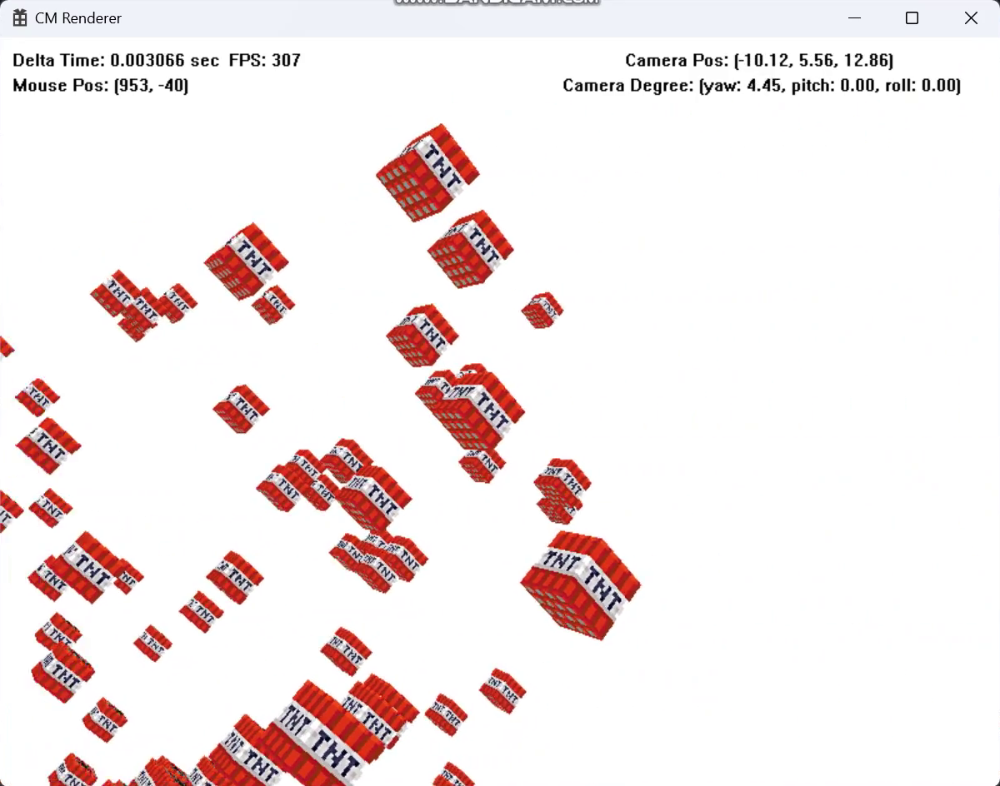
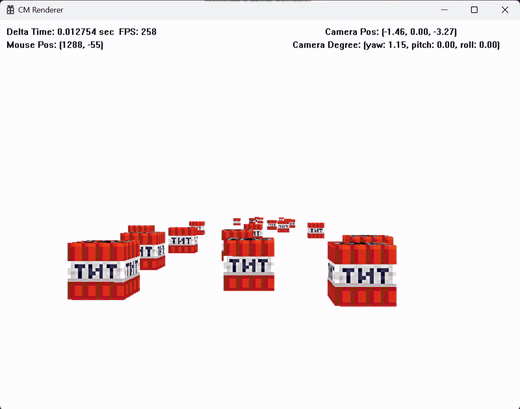
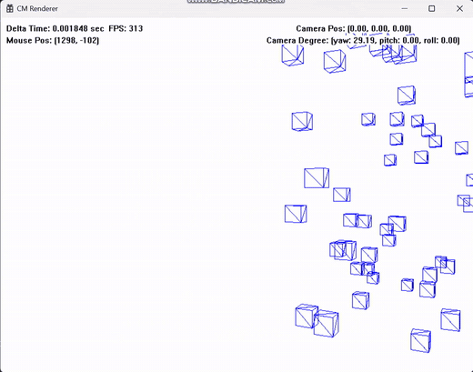

# Software Renderer

GPU와 그래픽스 API 없이 C++과 Win32 API만으로 만든 소프트웨어 렌더러입니다.
2024년 8월부터 9월까지 픽셀 하나를 찍는 함수에서 출발해 선 그리기, 삼각형 채우기, 3D 변환, 원근 투영, 텍스처 매핑, 깊이 버퍼, 절두체 컬링, 삼각형 클리핑, 사원수 회전까지 렌더링 파이프라인의 각 단계를 직접 구현했습니다.

각 단계를 구현할 때마다 필요한 수학을 정리하고 결과를 [블로그](https://powerclabman.tistory.com/category/%EC%BB%B4%ED%93%A8%ED%84%B0%20%EA%B7%B8%EB%9E%98%ED%94%BD%EC%8A%A4)에 기록했습니다.
이 저장소는 그 기록과 당시 녹화한 실행 영상을 단계 순서대로 다시 묶은 것입니다.
원본 프로젝트 파일은 남아 있지 않아, [Source](Source) 폴더의 코드는 블로그에 올린 코드를 모아 복원했습니다. 자세한 내용은 [코드 복원](#코드-복원)에 정리했습니다.

## Contents

- [2D 래스터화](#2d-래스터화)
- [3D 와이어프레임](#3d-와이어프레임)
- [백페이스 컬링](#백페이스-컬링)
- [원근 투영](#원근-투영)
- [원근 보정 텍스처 매핑](#원근-보정-텍스처-매핑)
- [깊이 버퍼](#깊이-버퍼)
- [절두체 컬링](#절두체-컬링)
- [삼각형 클리핑](#삼각형-클리핑)
- [사원수 회전](#사원수-회전)
- [트랜스폼 계층](#트랜스폼-계층)
- [코드 복원](#코드-복원)
- [블로그 기록](#블로그-기록)

## 2D 래스터화

### 선 그리기

처음에는 두 점 사이를 매개변수 t로 보간하며 점을 찍었습니다.
이 방법은 t의 증가량에 따라 점을 너무 많이 혹은 적게 찍고, 매번 부동소수점 곱셈을 하는 문제가 있었습니다.
픽셀 좌표는 결국 정수이므로, 정수 덧셈만으로 다음 픽셀을 고르는 브레젠험 알고리즘으로 바꿨습니다.
다음 픽셀의 중점 (x+1, y+0.5)가 직선 위에 있는지 아래에 있는지를 판별식 f로 판단하고, 판별식의 변화량 t와 s를 미리 구해 두어 루프 안에서는 덧셈만 합니다.
기울기가 완만한 경우와 급한 경우를 나눠 x와 y 중 항상 증가하는 축을 바꿉니다.

화면 밖으로 나가는 선은 코헨-서더랜드 알고리즘으로 잘랐습니다.
두 끝점의 영역 코드를 비교해 둘 다 안쪽이면 그대로 그리고, 같은 바깥 영역을 공유하면 버리고, 그 외에는 경계와의 교점으로 끝점을 옮기며 반복합니다.

[DrawLine.cpp](Source/03_Rasterizer2D/DrawLine.cpp)

### 모델링 행렬

크기, 회전, 이동 변환을 행렬로 표현했습니다.
이동 변환은 선형 변환이 아니어서 2×2 행렬 곱으로 나타낼 수 없기 때문에, 차원을 하나 높여 z = 1 평면에서의 전단 변환으로 이동을 표현하고 모든 변환을 3×3 행렬로 통일했습니다.
행렬 곱은 교환법칙이 성립하지 않으므로 적용 순서를 정해야 했습니다. 회전 후 크기를 바꾸면 강체의 성질이 깨지기 때문에 크기 → 회전 → 이동 순으로 곱했습니다.

`Transformer` 컴포넌트가 위치, 각도, 크기, 로컬 기저 벡터를 가지고 `GetModelMatrix`로 모델링 행렬을 만듭니다.
`RenderManager`는 와이어프레임의 정점 버퍼와 인덱스 버퍼를 꺼내 `VertexShader2D`에서 정점마다 모델링 행렬을 곱한 뒤, 인덱스 쌍마다 선을 그립니다.

*모델링 행렬로 이동, 회전, 크기 변환한 사각형. 화면에 Transformer의 위치, 크기, 각도를 함께 출력했습니다.*

[ModelingMatrix.cpp](Source/03_Rasterizer2D/ModelingMatrix.cpp)

### 2D 카메라

카메라도 이동, 회전, 크기 변환을 가지므로 자신의 모델링 행렬이 있습니다.
화면에 그려지는 것은 카메라가 비추는 영역이므로, 카메라를 원점과 기본 각도, 1배 크기로 되돌리는 변환을 모든 오브젝트에 적용해야 합니다.
이 변환이 카메라 모델링 행렬의 역행렬인 뷰 행렬입니다. `Camera2D::GetViewMatrix`는 역행렬을 일반적으로 구하지 않고, 이동·회전·크기의 역변환을 곱한 결과를 바로 채웁니다.

[Camera2D.h](Source/03_Rasterizer2D/Camera2D.h)

### 삼각형 채우기와 텍스처

삼각형을 감싸는 가장 작은 사각형을 구한 뒤, 그 안의 픽셀마다 삼각형 내부에 있는지 검사했습니다.
한 꼭짓점에서 다른 두 꼭짓점으로 향하는 벡터 u, v와 픽셀로 향하는 벡터 w의 내적으로 무게중심 좌표 s, t를 구하고, s, t, 1 − s − t가 모두 [0, 1]에 있으면 픽셀을 찍습니다.
분모가 0인 경우는 세 점이 한 직선 위에 있는 퇴화 삼각형이므로 그리지 않습니다.

같은 무게중심 좌표로 꼭짓점 색을 섞으면 색 보간이 되고, 꼭짓점의 UV 좌표를 섞으면 텍스처 매핑이 됩니다.

*무게중심 좌표로 꼭짓점 색을 보간해 채운 사각형. 배경 격자와 함께 2D 카메라가 이동하고 회전합니다.*

*같은 방식으로 UV 좌표를 보간해 이미지 텍스처를 입힌 사각형*

[DrawTriangle.cpp](Source/03_Rasterizer2D/DrawTriangle.cpp)

## 3D 와이어프레임

2D 구조의 차원을 하나씩 올려 `Vector3D`, `Vertex3D`, 4×4 행렬, `Transformer3D`를 만들었습니다.
3D에서는 회전축이 하나가 아니므로 회전 행렬을 정하는 방법이 필요했습니다. 처음에는 직관적인 오일러 각을 사용했습니다.
표준 기저 x, y, z축을 각각 피치, 요, 롤의 회전축으로 두고, 롤 → 피치 → 요 순서로 회전합니다.
열벡터 방식이므로 요 × 피치 × 롤 × 벡터 순서로 곱하고, 결과 행렬의 각 열이 오브젝트의 로컬 기저 벡터가 됩니다.

이 단계에서는 정점의 z값을 버리고 x, y만으로 삼각형을 그렸기 때문에 아직 원근감은 없습니다.

*12개의 삼각형으로 만든 육면체를 오일러 각으로 회전*

오일러 각은 회전 도중 두 회전축이 겹쳐 자유도 하나를 잃는 짐벌락 현상이 있습니다.
아래 영상 중반부터는 롤을 바꾸든 요를 바꾸든 같은 방향으로 회전합니다. 이 문제는 이후 [사원수 회전](#사원수-회전)으로 해결했습니다.

*오일러 각 회전에서 나타난 짐벌락*

[Wireframe3D.cpp](Source/04_Pipeline3D/Wireframe3D.cpp)

## 백페이스 컬링

육면체의 면 중 카메라를 등진 후면은 보이지 않으므로 그릴 필요가 없습니다.
모든 삼각형을 반시계 방향으로 정의해 두면, 변환된 세 정점으로 만든 두 변의 외적이 면의 법선이 됩니다.
이 법선과 카메라 시선 벡터의 내적이 0 이상이면 후면으로 판단하고 삼각형을 건너뜁니다.

이를 위해 육면체의 정점 정의 순서를 다시 맞췄습니다.
기저 벡터의 양수 쪽 면(앞면, 오른쪽 면, 윗면)은 반시계 방향으로, 음수 쪽 면(뒷면, 왼쪽 면, 아랫면)은 시계 방향으로 인덱스를 지정했습니다.
블로그에는 이 변경으로 성능이 10% 정도 올랐다고 기록했습니다.

*후면을 제거해 보이는 면의 모서리만 남은 육면체*

[BackFaceCulling.cpp](Source/04_Pipeline3D/BackFaceCulling.cpp)

## 원근 투영

### 뷰 변환

3D 카메라도 2D와 같이 카메라 모델링 행렬의 역행렬을 뷰 행렬로 사용합니다.
카메라가 양의 z축 방향에서 바라보도록 설계했더니 렌즈와 마주 보는 형태가 되어, 뷰 행렬에서 Right와 Out 기저 축의 부호를 뒤집어 y축 기준으로 180° 돌렸습니다.

### 투영 행렬

정점을 카메라 앞의 투영 평면(NDC, 상하좌우 [−1, 1])에 투영하면 멀리 있는 물체가 작게 보입니다.
화각 θ에서 초점거리 d = 1 / tan(θ/2)를 구하고, 닮은 삼각형의 비로 투영된 좌표 x' = d·x / (−z), y' = d·y / (−z)를 얻었습니다.

−z로 나누는 값은 정점마다 다르므로 행렬에 넣으면 정점 수만큼 행렬이 필요합니다.
그래서 행렬에는 d만 곱하고, 정점 셰이더에서 행렬을 곱한 뒤 마지막에 −z로 나누도록 나눴습니다. 행렬을 곱한 직후의 공간이 클립 좌표계, 나눈 뒤의 공간이 NDC입니다.
NDC 좌표에 화면 크기의 절반(800×600 기준 400, 300)을 곱해 화면 좌표로 늘립니다.

### 종횡비

1:1인 NDC를 4:3 화면으로 늘리면 정육면체가 가로로 긴 직육면체처럼 보입니다.
x 좌표에 종횡비의 역수를 곱해야 하는데, 정점마다 연산을 추가하지 않고 투영 행렬의 첫 행에 1/a를 넣었습니다.

<table>
  <tr>
    <td align="center"></td>
    <td align="center"></td>
  </tr>
  <tr>
    <td align="center">종횡비 고려 전</td>
    <td align="center">종횡비를 반영한 투영 행렬</td>
  </tr>
</table>

[Perspective_TextureMapping.cpp](Source/04_Pipeline3D/Perspective_TextureMapping.cpp)

## 원근 보정 텍스처 매핑

`Texture` 클래스는 비트맵을 읽어 픽셀 색을 배열에 저장하고, UV 좌표를 넣으면 해당 픽셀의 색을 돌려줍니다.
삼각형 채우기에서 구한 무게중심 좌표로 세 정점의 UV를 보간하고, 그 UV로 텍스처 색을 가져와 픽셀을 찍습니다.

처음 결과는 면이 기울어질수록 텍스처가 찌그러졌습니다.
무게중심 좌표를 투영된 정점으로 계산했기 때문입니다. 투영은 선형 변환이 아니어서 화면에서의 무게중심 s와 뷰 공간에서의 무게중심 t가 다릅니다.
두 점 사이 보간식을 정리해 화면의 무게중심 si와 뷰 공간의 깊이 zi로 뷰 공간 무게중심 ti = si · z' / zi를 구하는 식을 유도했습니다.
z'는 계수의 합이 1이라는 조건에서 z' = 1 / Σ(si / zi)로 얻습니다. 코드에서는 각 정점의 W(뷰 공간 깊이)의 역수를 미리 구해 두고 픽셀마다 이 식을 적용합니다.

*왼쪽은 화면 공간에서 보간한 결과, 오른쪽은 원근 보정 보간 결과*

[Perspective_TextureMapping.cpp](Source/04_Pipeline3D/Perspective_TextureMapping.cpp)

## 깊이 버퍼

여러 상자를 배치하자 뒤에 있는 상자가 앞의 상자를 뚫고 그려졌습니다. 오브젝트를 그리는 순서가 정해져 있지 않기 때문입니다.
오브젝트를 깊이순으로 정렬하는 대신, 픽셀마다 깊이를 기록하는 Z-버퍼 방식을 사용했습니다.

기존 투영 행렬은 NDC로 나누고 나면 z가 항상 1이 되어 깊이 정보가 사라집니다.
근평면 n과 원평면 f를 정하고, 근평면의 점이 z = −1, 원평면의 점이 z = 1로 가도록 투영 행렬의 세 번째 행 e1 = (n + f) / (n − f), e2 = 2nf / (n − f)를 연립방정식으로 구했습니다.
네 번째 행은 (0, 0, −1, 0)이 되어 클립 좌표의 w에 뷰 공간 깊이가 담깁니다.

화면 크기만큼 float 버퍼를 만들어 매 프레임 무한대로 초기화하고, 텍스처 매핑 루프에서 픽셀을 찍기 전에 깊이를 비교합니다.
깊이 값도 투영 전 공간에서 보간해야 하므로 원근 보정 보간으로 구한 계수를 그대로 사용했습니다.

*깊이 테스트를 적용해 앞의 상자가 뒤의 상자를 가리는 장면*

*깊이 버퍼 유무에 따른 차이*

[DepthBuffer.cpp](Source/04_Pipeline3D/DepthBuffer.cpp)

## 절두체 컬링

화면에 아무것도 보이지 않아도 모든 정점에 모델링, 뷰, 투영 변환이 수행되고 있었습니다.
카메라가 볼 수 있는 공간은 잘린 피라미드 모양의 절두체(가시 부피)이므로, 그 밖의 오브젝트는 변환 전에 걸러낼 수 있습니다.

### 평면과 점의 판정

평면을 정규화된 법선 n과 d로 정의하면 n · p + d의 부호로 점이 평면의 바깥에 있는지 알 수 있습니다.
`Plane`은 항상 정규화된 법선으로 만들어지고, `Frustum`은 6개의 평면을 가지고 한 평면에서라도 바깥이면 바깥으로 판정합니다.
처음에는 오브젝트 위치를 뷰 공간으로 옮겨 이 점 하나로 판정했습니다.

### 종횡비와 투영 행렬로 만든 평면

처음 만든 절두체는 종횡비를 고려하지 않아 좌우가 정사각형 범위로 잘렸습니다.
좌우 평면은 초점거리 d와 종횡비 a로 만든 빗변에서 cos, sin을 직접 계산해 다시 정의했습니다.

이후 클립 좌표계의 범위 조건 −w ≤ x, y, z ≤ w를 이용하는 방법으로 바꿨습니다.
투영 행렬의 각 행을 r0 ~ r3이라 하면 이 부등식은 뷰 공간의 점 v에 대해 (±ri − r3) · v ≤ 0이 되므로, 투영 행렬의 행 조합만으로 6개 평면을 얻습니다.
최종 버전에서는 투영·뷰·모델링 행렬을 곱한 행렬의 행으로 평면을 만들어 오브젝트의 로컬 공간에서 바로 판정합니다.

*절두체 밖의 오브젝트는 정점 변환 전에 제외됩니다.*

### AABB

점 하나로 판정하면 중심은 밖에 있지만 일부가 화면에 걸친 오브젝트가 사라집니다.
메시 정점의 최소, 최대 좌표로 축 정렬 경계 상자(AABB)를 만들고, 평면 법선 방향에 따라 상자에서 가장 가까운 점과 가장 먼 점을 골라 판정했습니다.
가까운 점이 바깥이면 완전히 밖(OUTSIDE), 먼 점만 바깥이면 걸침(INTERSECT), 둘 다 안이면 안(INSIDE)입니다.

*AABB로 판정한 와이어프레임 테스트. 상자가 시야 밖으로 나가면 렌더링 대상에서 빠지고 FPS가 오릅니다.*

아래 영상에서는 동작을 확인하기 위해 경계에 걸친(INTERSECT) 오브젝트만 와이어프레임으로 그렸습니다.

*텍스처를 입힌 오브젝트에 적용한 최종 절두체 컬링*

[FrustumCulling.cpp](Source/05_Culling_Clipping/FrustumCulling.cpp)

## 삼각형 클리핑

큰 삼각형 위를 카메라가 지나가면 선이 갑자기 늘어나고 텍스처가 깨졌습니다.
카메라 뒤에 있는 정점까지 투영되면서 생긴 문제입니다. 화면 앞의 정점만 남기면 삼각형을 이룰 수 없으므로, 삼각형을 절두체 경계에서 잘라 새로 만들어야 했습니다.

*클리핑 전. 카메라 뒤 정점이 투영되면서 삼각형이 비정상적으로 늘어납니다.*

클리핑은 계산이 간단한 클립 좌표계에서 NDC로 나누기 전에 수행합니다.
근평면은 z = −w이므로, 선분 P1P2 위의 점을 보간식으로 두고 z와 w 성분만 비교하면 교점의 비율 t = (w2 + z2) / ((w2 + z2) − (w1 + z1))을 바로 얻습니다.
같은 방식으로 6개 평면마다 바깥 판정 함수와 교점 계산 함수를 만들고, 위치뿐 아니라 색과 UV도 같은 비율로 보간했습니다.

삼각형마다 6개 평면에 대해 순서대로 다음을 적용합니다.

| 바깥 정점 수 | 처리 |
|---|---|
| 0 | 그대로 둡니다. |
| 1 | 잘린 부분이 사각형이 되므로 교점 두 개를 구해 삼각형 두 개로 나눕니다. |
| 2 | 바깥 정점 두 개를 교점으로 옮겨 삼각형을 축소합니다. |
| 3 | 삼각형을 그리지 않습니다. |

새로 만든 삼각형은 원래 삼각형과 같은 방향으로 정점을 정의해야 백페이스 컬링에서 잘못 제거되지 않습니다.

*경계에서 잘린 삼각형*

*클리핑 적용 후 카메라가 상자 사이를 가까이 지나가도 화면이 깨지지 않습니다.*

[TriangleClipping.cpp](Source/05_Culling_Clipping/TriangleClipping.cpp)

## 사원수 회전

짐벌락을 해결하기 위해 회전을 사원수로 바꿨습니다.
사원수를 실수부 a와 허수부 벡터 v의 쌍 q = (a, v)로 두면 곱셈은 (a₁a₂ − v₁ · v₂, a₁v₂ + a₂v₁ + v₁ × v₂)로 정리됩니다.
벡터 회전 q v q*는 외적 두 번으로 줄인 v + w·t + u × t (t = 2u × v) 형태로 구현했습니다.

`Transformer3D`가 오일러 각 대신 사원수를 회전 상태로 가지고, 사람이 다루기 쉬운 오일러 각과 사원수, 회전 행렬 사이의 변환 함수를 만들었습니다.
두 회전 사이를 부드럽게 잇는 구면 선형 보간(Slerp)도 구현했습니다. 두 사원수의 내적이 음수면 한쪽을 반전해 짧은 경로로 보간하고, 내적이 1에 가까우면 선형 보간으로 대체합니다.

[Quaternion.cpp](Source/06_Rotation/Quaternion.cpp) · [Slerp.cpp](Source/06_Rotation/Slerp.cpp)

## 트랜스폼 계층

마지막으로 부모의 트랜스폼을 자식이 이어받는 계층 구조를 추가했습니다.
아래 영상에서는 가운데 구를 중심으로 자식 구가 공전하고, 그 자식 구 주위를 다시 작은 구가 공전합니다.

*부모를 따라 공전하는 자식 오브젝트*

이후 FBX 메시를 불러와 출력하는 것까지 시도했습니다. 기본적인 메시는 출력됐지만, 본 계층 정보를 해석하지 못해 애니메이션은 미완성으로 남았습니다.

## 코드 복원

원본 프로젝트 파일은 남아 있지 않습니다.
[Source](Source) 폴더의 코드는 블로그 글에 올린 코드를 단계별로 모은 것이며, 각 파일 첫 줄에 출처 글을 적었습니다.

- 블로그에 텍스트로 올린 코드는 원문 그대로 옮겼습니다.
- 3D 파이프라인 이후의 글은 코드를 스크린샷으로 올려, 이미지를 보고 옮겨 적었습니다. 오타가 있을 수 있습니다.
- `Vector2D`, `Vector4D`, `Color32`, `DrawPixel`, 엔진 구조와 입력 처리처럼 블로그에 싣지 않은 부분은 포함되어 있지 않아 이 코드만으로는 빌드되지 않습니다.

| 폴더 | 내용 |
|---|---|
| [01_Framework](Source/01_Framework) | Win32 창 생성과 메인 루프 |
| [02_Math](Source/02_Math) | 벡터, 3×3 행렬, 평면, 회전 행렬 → 사원수 |
| [03_Rasterizer2D](Source/03_Rasterizer2D) | 선 그리기, 선 클리핑, 모델링 행렬, 2D 카메라, 삼각형 채우기 |
| [04_Pipeline3D](Source/04_Pipeline3D) | 3D 와이어프레임, 백페이스 컬링, 원근 투영, 텍스처 매핑, 깊이 버퍼 |
| [05_Culling_Clipping](Source/05_Culling_Clipping) | 절두체 컬링, AABB, 삼각형 클리핑 |
| [06_Rotation](Source/06_Rotation) | 사원수, Slerp |

## 블로그 기록

구현 과정과 수식 유도는 블로그에 단계별로 정리했습니다.

- [선 그리기 (브레젠험 알고리즘, 코헨-서더랜드 클리핑 알고리즘)](https://powerclabman.tistory.com/144)
- [모델링 행렬 설계](https://powerclabman.tistory.com/145)
- [2D 카메라 설계](https://powerclabman.tistory.com/147)
- [색칠된 삼각형 그리기](https://powerclabman.tistory.com/149)
- [가볍게 구현해본 3D 와이어 프레임 랜더링](https://powerclabman.tistory.com/151)
- [백 페이스 컬링](https://powerclabman.tistory.com/152)
- [3D 카메라 설계 수정, 원근법 구현](https://powerclabman.tistory.com/153)
- [깊이 구현](https://powerclabman.tistory.com/154)
- [가시부피와 절단](https://powerclabman.tistory.com/155)
- [삼각형 클리핑](https://powerclabman.tistory.com/156)
- [짐벌락 없는 사원수 회전](https://powerclabman.tistory.com/157)
- [구형 선형 보간으로 회전 보간](https://powerclabman.tistory.com/159)
- [직접 만든 그래픽 엔진으로 여러가지 출력](https://powerclabman.tistory.com/161)

렌더러에 사용한 수학은 [컴퓨터 그래픽스 / 수학](https://powerclabman.tistory.com/category/%EC%BB%B4%ED%93%A8%ED%84%B0%20%EA%B7%B8%EB%9E%98%ED%94%BD%EC%8A%A4/%EC%88%98%ED%95%99) 카테고리에 따로 정리했습니다.
"# Software-Rasterizer" 
