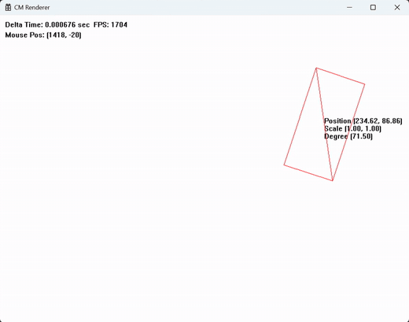
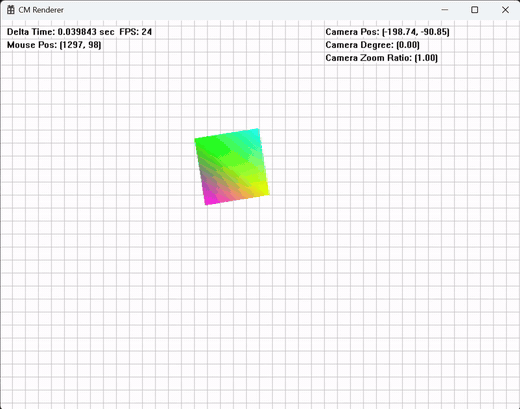
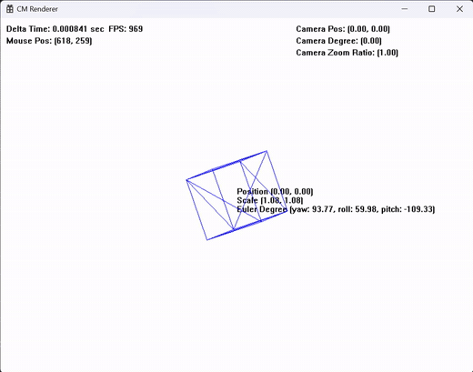
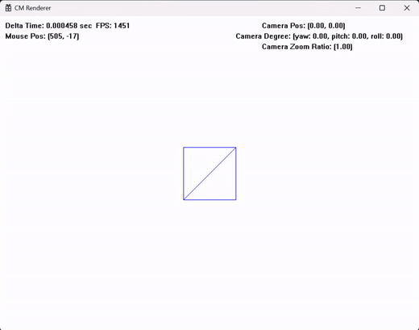
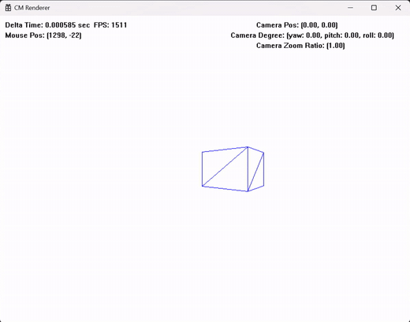
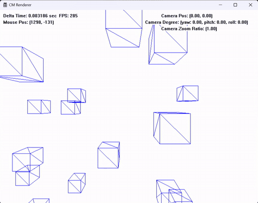
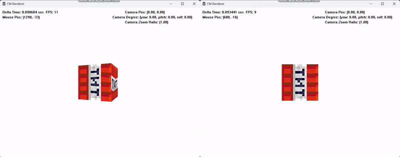
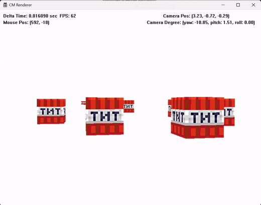
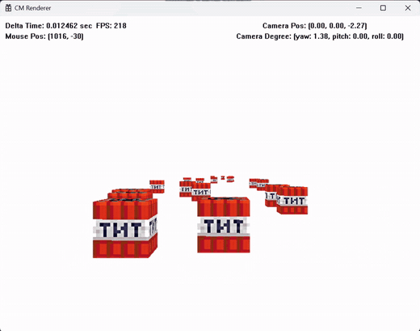
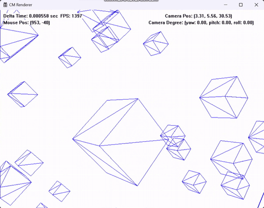

<h1 align="center">소프트웨어 래스터라이저 개발 기록</h1>

C++과 Win32 API로 2D 선 그리기부터 3D 렌더링 파이프라인까지 구현한 기록

  
  

## 목차

* [프로젝트 소개](#프로젝트-소개)
* [2D 래스터화](#2d-래스터화)
* [3D 변환과 투영](#3d-변환과-투영)
* [원근 보정 텍스처 매핑](#원근-보정-텍스처-매핑)
* [깊이 버퍼](#깊이-버퍼)
* [로컬 공간의 절두체 컬링](#로컬-공간의-절두체-컬링)
* [클립 공간의 삼각형 클리핑](#클립-공간의-삼각형-클리핑)
* [사원수 회전](#사원수-회전)
* [트랜스폼 계층과 메시 출력](#트랜스폼-계층과-메시-출력)
* [개발 기록](#개발-기록)

## 프로젝트 소개

정점 데이터가 화면의 픽셀이 되기까지 어떤 계산을 거치는지 확인하려고 소프트웨어 래스터라이저를 만들었습니다. 2024년 1월부터 9월까지 그래픽스에 필요한 수학을 공부하고, C++로 정점 변환과 투영, 삼각형 채우기, 가시성 판정을 구현했습니다. 렌더링은 CPU에서 계산하고, 완성한 픽셀을 Win32 API로 창에 출력했습니다.

2D 선과 삼각형에서 시작해, 카메라 시점에 맞춰 텍스처와 가림을 계산하는 3D 장면까지 구현했습니다.

- 래스터화: 브레젠험 선 그리기, 무게중심좌표 기반 삼각형 채우기와 색·UV 보간
- 3D 파이프라인: 모델·뷰·투영 변환, 원근 보정 텍스처 매핑, 깊이 버퍼, 백페이스 컬링
- 가시성 처리: 로컬 공간 AABB 절두체 컬링, 클립 공간 삼각형 클리핑
- 회전: 짐벌락을 피하기 위한 사원수와 Slerp, 트랜스폼 계층

아래 섹션은 구현 순서를 따르며, 각 단계에서 생긴 문제와 해결 과정을 실행 영상과 함께 보여 줍니다.

## 2D 래스터화

### 선 그리기와 색 보간

두 점 사이를 일정 간격으로 보간하면 간격에 따라 픽셀이 중복되거나 비었습니다. 브레젠험 알고리즘의 정수 판별식으로 다음 픽셀을 고르고, 선이 화면 경계를 넘으면 코헨–서더랜드 알고리즘으로 경계 안의 구간만 남겼습니다. 정수 색 보간에서 생긴 계단 현상은 채널을 `Color128`의 넓은 정수로 계산한 뒤, 픽셀을 찍을 때 `Color32`로 변환해 줄였습니다.

### 모델링 행렬과 카메라

크기 → 회전 → 이동 순으로 적용하는 모델링 행렬을 만들어 로컬 정점을 월드에 배치했습니다. 카메라 모델링 행렬의 역행렬을 뷰 행렬로 사용해, 월드를 카메라 기준 좌표로 옮겼습니다.

### 삼각형 채우기와 텍스처

삼각형의 경계 사각형을 훑고, 무게중심좌표의 세 계수가 모두 0과 1 사이인 픽셀을 채웠습니다. 같은 계수로 정점 색을 섞으면 색이 이어지고, UV를 보간하면 이미지에서 읽을 위치가 정해집니다.

| 정점 색 보간과 2D 카메라 | UV 보간으로 입힌 텍스처 |
| --- | --- |
|  |  |

## 3D 변환과 투영

### 와이어프레임과 백페이스 컬링

정점과 변환을 3D 벡터와 4×4 행렬로 확장했습니다. 정점·인덱스 버퍼에 육면체를 정의하고, 오일러 각으로 회전한 삼각형 12개의 모서리를 그렸습니다. 각 삼각형의 법선은 두 변의 외적으로 구하고, 카메라 시선과 내적해 뒷면을 건너뛰었습니다. 면마다 정점 순서를 맞추자 카메라를 향하는 면의 선만 남았습니다.

| 3D 와이어프레임 | 백페이스 컬링 적용 |
| --- | --- |
|  |  |

### 카메라와 원근 투영

뷰 공간에서 카메라 앞쪽을 음의 z 방향으로 두고, 화각과 깊이에 따라 먼 물체가 작아지도록 원근 투영을 구현했습니다. 모델·뷰·투영 행렬로 클립 좌표를 구한 다음 w로 나누어 정규화 장치 좌표(NDC)를 얻고, 화면 좌표로 변환합니다. 가로로 늘어난 상자는 투영 행렬의 x 방향에 종횡비의 역수(세로/가로)를 반영해 바로잡았습니다.

| 종횡비 보정 전 | 종횡비 보정 후 |
| --- | --- |
|  |  |

## 원근 보정 텍스처 매핑

화면 공간의 무게중심좌표로 UV를 그대로 보간하자, 3D 상자가 기울 때 면의 텍스처가 찌그러졌습니다. 원근 나눗셈에서 정점마다 다른 깊이를 사용하므로 투영 전과 후의 보간 비율이 달라집니다.

화면에서 구한 계수 λ를 각 정점의 클립 좌표 w로 나눈 뒤 합이 1이 되도록 정규화했습니다. 이 렌더러에서 w는 뷰 공간 깊이(−z)입니다. 보정한 계수 β로 UV를 보간하자 상자가 회전해도 텍스처가 면의 형태를 따라갔습니다.

$$
\beta_i = \frac{\lambda_i / w_i}{\lambda_0 / w_0 + \lambda_1 / w_1 + \lambda_2 / w_2}
$$

## 깊이 버퍼

상자가 겹치면 나중에 그린 면이 앞쪽 면을 덮었습니다. 투영 행렬에 근평면과 원평면을 반영해 NDC의 z에 깊이를 남기고, 화면 크기의 깊이 버퍼를 매 프레임 초기화했습니다. 삼각형을 채울 때 픽셀의 깊이를 비교해 더 가까운 면의 색과 깊이만 기록하자, 그리기 순서와 관계없이 앞쪽 면이 보였습니다.

## 로컬 공간의 절두체 컬링

절두체의 여섯 평면을 검사해 시야 밖 물체를 정점 변환 전에 제외했습니다. 처음에는 중심점으로 판정했지만, 중심이 시야 밖인 물체는 화면에 걸친 부분까지 사라졌습니다. 메시의 좌표 최솟값과 최댓값으로 축 정렬 경계 상자(AABB)를 만든 뒤, 평면마다 법선에 대한 투영값이 가장 크고 작은 꼭짓점을 검사해 경계에 걸친 물체를 남겼습니다.

클립 공간 조건 −w ≤ x, y, z ≤ w를 로컬 좌표에 대한 부등식으로 풀어, 이미 계산한 모델·뷰·투영 행렬의 행에서 절두체 평면을 구했습니다. 그래서 경계 상자의 정점을 매번 변환하지 않고 로컬 공간에서 바로 판정할 수 있었습니다.

| 중심점으로 판정 | 로컬 경계 상자로 판정 |
| --- | --- |
|  |  |

## 클립 공간의 삼각형 클리핑

카메라 뒤의 정점을 그대로 투영하면 음수인 w로 나누면서 정점이 화면 반대편으로 뒤집혔습니다. 카메라가 상자 위를 지날 때 모서리가 길게 늘어지고 텍스처가 깨진 이유입니다.

원근 나눗셈 전에 클립 좌표에서 절두체의 여섯 평면으로 삼각형을 잘랐습니다. 예를 들어 근평면에서 두 끝점의 판정값을 각각 `d = z + w`로 구하면, 교점은 변의 `t = dA / (dA − dB)` 위치에 있습니다. 같은 t로 새 정점의 색과 UV를 보간하고, 백페이스 컬링이 올바르게 작동하도록 원래 정점 순서를 유지했습니다.

| 평면 밖의 정점 수 | 처리 |
| ---: | --- |
| 0 | 삼각형을 그대로 유지 |
| 1 | 교점 두 개로 남은 사각형을 만들고 삼각형 두 개로 분할 |
| 2 | 교점 두 개와 내부 정점으로 삼각형 하나를 구성 |
| 3 | 삼각형을 제외 |

| 경계에서 생성된 삼각형 | 여러 물체를 그린 결과 |
| --- | --- |
|  |  |

## 사원수 회전

오일러 각에서 피치가 90°에 이르면 롤과 요의 회전축이 겹쳐 한 축의 자유도를 잃습니다. 영상에서는 롤과 요를 각각 바꿔도 상자가 같은 방향으로 회전합니다.

회전 상태를 사원수로 저장하고, 오일러 각 입력은 사원수로 변환해 적용했습니다. 정점을 변환할 때는 사원수에서 회전행렬을 얻습니다. 두 회전 사이에는 구면 선형 보간(Slerp)을 적용하고, 두 사원수의 내적으로 짧은 회전 경로를 고를 수 있게 했습니다.

## 트랜스폼 계층과 메시 출력

부모의 변환을 자식과 손자까지 이어받도록 트랜스폼을 연결했습니다. 구체가 부모 구체를 중심으로 공전하는 장면으로 계층을 확인했습니다. 이후 기본 FBX 메시를 출력하고 하이 폴리 모델을 그리는 실험도 진행했습니다.

## 개발 기록

| 구현 단계 | 블로그 원문 |
| --- | --- |
| 2D 래스터화 | [선 그리기](https://powerclabman.tistory.com/144) · [모델링 행렬](https://powerclabman.tistory.com/145) · [색 보간 실습](https://powerclabman.tistory.com/146) · [카메라](https://powerclabman.tistory.com/147) · [삼각형 채우기](https://powerclabman.tistory.com/149) · [텍스처 매핑](https://powerclabman.tistory.com/150) |
| 3D 변환과 가시성 | [와이어프레임](https://powerclabman.tistory.com/151) · [백페이스 컬링](https://powerclabman.tistory.com/152) · [원근 투영과 보간](https://powerclabman.tistory.com/153) · [깊이 버퍼](https://powerclabman.tistory.com/154) · [절두체 컬링](https://powerclabman.tistory.com/155) · [삼각형 클리핑](https://powerclabman.tistory.com/156) |
| 회전과 확장 실험 | [사원수 회전](https://powerclabman.tistory.com/157) · [Slerp](https://powerclabman.tistory.com/159) · [트랜스폼 상속과 메시 출력](https://powerclabman.tistory.com/161) |

수학 학습 기록

- 2024.01.31 — [함수에 대해서](https://powerclabman.tistory.com/78)
- 2024.02.01 — [벡터](https://powerclabman.tistory.com/82)
- 2024.02.03 — [선형결합, 기저와 차원](https://powerclabman.tistory.com/86)
- 2024.02.03 — [삼각함수](https://powerclabman.tistory.com/87)
- 2024.06.27 — [수: 가상 세계를 구성하는 가장 작은 단위](https://powerclabman.tistory.com/110)
- 2024.06.27 — [벡터: 가상 공간의 탄생](https://powerclabman.tistory.com/111)
- 2024.06.28 — [삼각함수: 회전을 위한 수학](https://powerclabman.tistory.com/112)
- 2024.06.28 — [행렬: 가상 세계의 변환 도구](https://powerclabman.tistory.com/113)
- 2024.06.30 — [공부 목적으로 사용할 수학 라이브러리](https://powerclabman.tistory.com/116)
- 2024.07.11 — [아핀 공간: 움직이는 가상 세계의 구축](https://powerclabman.tistory.com/123)
- 2024.07.11 — [내적: 벡터 공간의 분석과 응용](https://powerclabman.tistory.com/124)
- 2024.07.12 — [삼각형: 물체를 구성하는 가장 작은 단위](https://powerclabman.tistory.com/125)
- 2024.07.19 — [3차원 공간: 입체 공간의 생성](https://powerclabman.tistory.com/128)
- 2024.07.20 — [외적: 3차원 공간의 분석과 응용](https://powerclabman.tistory.com/129)
- 2024.07.20 — [원근 투영: 화면에 현실감을 부여하는 변환](https://powerclabman.tistory.com/130)
- 2024.07.21 — [절두체: 최적화된 3차원 공간](https://powerclabman.tistory.com/135)
- 2024.07.24 — [복소수: 2차원 평면의 수](https://powerclabman.tistory.com/136)
- 2024.07.25 — [오일러 공식: 허수로 표현하는 회전 변환](https://powerclabman.tistory.com/137)
- 2024.07.27 — [오일러 공식 증명](https://powerclabman.tistory.com/138)
- 2024.07.30 — [사원수: 4차원 수로 설계한 3차원 회전](https://powerclabman.tistory.com/140)
- 2024.08.09 — [컨벡스 결합에 대한 삽질](https://powerclabman.tistory.com/148)

