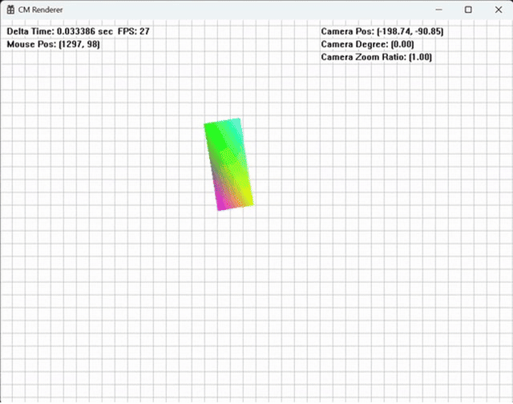
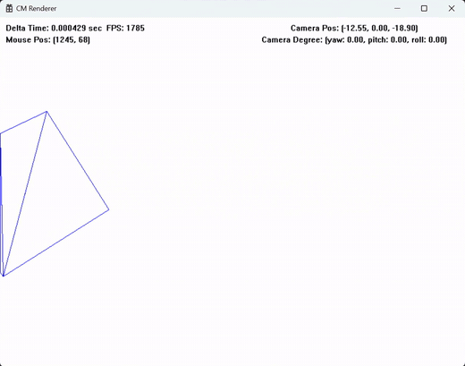

<h1 align="center">소프트웨어 래스터라이저 개발 기록</h1>

C++과 Win32 API로 구현한 소프트웨어 래스터라이저 학습·개발 기록

  
  

## Contents

* [프로젝트 소개](#프로젝트-소개)
* [원근 보정 텍스처 매핑](#원근-보정-텍스처-매핑)
* [로컬 공간의 절두체 컬링](#로컬-공간의-절두체-컬링)
* [클립 공간의 삼각형 클리핑](#클립-공간의-삼각형-클리핑)
* [사원수 회전](#사원수-회전)
* [개발 기록](#개발-기록)

## 프로젝트 소개

D3D11과 OpenGL에서는 API를 호출하면 화면이 그려지지만, 그 사이의 계산은 보이지 않습니다. 이 과정을 직접 확인하려고 GPU 없이 C++만으로 렌더링 파이프라인을 구현했습니다. 정점 변환, 원근 투영, 삼각형 래스터화, 텍스처 매핑, 깊이 버퍼, 컬링, 클리핑까지 CPU에서 계산하고, 결과 픽셀만 Win32 API로 창에 출력합니다.

2024년 1월부터 9월까지 필요한 수학을 공부하며 단계별로 구현하고 블로그에 기록했습니다. 원본 프로젝트는 분실했고, 이 저장소는 당시의 블로그 기록과 로컬 녹화본으로 구현 과정을 다시 정리한 것입니다. 그래서 소스 코드는 없고 실행 화면만 남아 있습니다.

## 원근 보정 텍스처 매핑

2D에서 쓰던 텍스처 매핑을 3D 상자에 적용하자, 상자가 회전할 때 기울어진 면의 텍스처가 찌그러졌습니다(왼쪽). 픽셀마다 화면에서 무게중심좌표를 구하고 그 비율로 세 정점의 UV를 섞었는데, 원근 투영은 정점마다 다른 깊이로 좌표를 나누므로 화면에서의 비율이 3D 공간의 비율과 같지 않습니다. 깊이 차이가 큰 면일수록 어긋남이 커집니다.

화면에서 구한 계수 λ를 각 정점의 클립 좌표 w로 나눈 뒤, 합이 다시 1이 되도록 정규화해 3D 공간의 비율로 되돌렸습니다. 이 렌더러에서 w는 카메라 공간의 깊이(−z)입니다.

$$
\beta_i = \frac{\lambda_i / w_i}{\lambda_0 / w_0 + \lambda_1 / w_1 + \lambda_2 / w_2}
$$

정점마다 1/w를 미리 구해 두고, 픽셀 루프에서 β를 계산합니다. 보정한 β로 UV를 보간하자 면이 기울어져도 텍스처가 면의 형태를 따라갔습니다(오른쪽).

## 로컬 공간의 절두체 컬링

화면 밖의 픽셀은 그리지 않았지만, 화면 밖 물체의 정점 변환은 계속 수행되고 있었습니다. 카메라가 볼 수 있는 절두체를 평면 여섯 개로 표현하고, 완전히 밖에 있는 물체는 정점 변환 전에 제외했습니다.

처음에는 물체의 중심점 하나로 판정했는데, 중심은 밖에 있어도 메시 일부가 화면에 걸치는 물체가 잘려 나갔습니다. 그래서 메시의 정점 최솟값과 최댓값으로 축 정렬 경계 상자(AABB)를 만들고, 평면 법선의 부호에 따라 상자의 가장 안쪽과 바깥쪽 꼭짓점을 골라 검사했습니다. 이렇게 하면 평면마다 꼭짓점 두 개만 보고 상자가 완전히 밖인지, 경계에 걸치는지, 안쪽인지를 구분할 수 있습니다. 위 화면에서 와이어프레임으로 보이는 상자가 경계에 걸쳤다고 판정된 물체입니다.

다음으로 판정을 수행하는 공간을 바꿨습니다. AABB를 매 프레임 뷰 공간으로 변환하면 축 정렬이 깨지고 꼭짓점 8개를 모두 변환해야 합니다. 반대로 절두체 평면을 물체의 로컬 공간으로 옮기면 원래 AABB를 그대로 쓸 수 있습니다. 클립 공간의 내부 조건 −w ≤ x, y, z ≤ w를 변환 전 좌표에 대한 부등식으로 풀면, 모델·뷰·투영을 합성한 행렬의 행을 더하고 빼는 것만으로 로컬 공간의 여섯 평면이 나옵니다. 물체마다 이미 계산하는 합성 행렬에서 평면을 꺼내므로, 추가 변환 없이 판정할 수 있습니다.

## 클립 공간의 삼각형 클리핑

카메라가 물체 위를 지나가면 선이 화면 끝까지 늘어나고 텍스처가 깨졌습니다. 큰 삼각형의 일부 정점이 카메라 뒤에 있는데 그대로 원근 나눗셈을 하면서, w가 음수인 정점이 화면 반대편으로 뒤집혀 투영된 것입니다. 이런 삼각형은 컬링으로 통째로 버릴 수도 없습니다. 보이는 부분이 남아 있기 때문입니다.

그래서 원근 나눗셈 전에 클립 좌표에서 삼각형을 절두체 경계로 잘랐습니다. 근평면은 클립 좌표에서 z + w = 0입니다. 변의 두 끝점 A, B에서 d = z + w를 구하면 교점의 위치는 다음과 같습니다.

$$
t = \frac{d_A}{d_A - d_B}, \qquad P = A + t(B - A)
$$

같은 t로 색과 UV도 보간합니다. 여섯 평면을 차례로 통과시키며, 평면 바깥에 있는 정점 수에 따라 삼각형을 다시 만듭니다.

<table width="100%">
  <thead>
    <tr>
      <th align="right">바깥 정점 수</th>
      <th align="left">처리</th>
    </tr>
  </thead>
  <tbody>
    <tr>
      <td align="right">0</td>
      <td>그대로 유지</td>
    </tr>
    <tr>
      <td align="right">1</td>
      <td>교점 두 개를 더해 남은 사각형을 삼각형 두 개로 분할</td>
    </tr>
    <tr>
      <td align="right">2</td>
      <td>교점 두 개로 작은 삼각형 하나를 만듦</td>
    </tr>
    <tr>
      <td align="right">3</td>
      <td>제외</td>
    </tr>
  </tbody>
</table>

새 삼각형도 원래 삼각형과 정점 순서를 같게 만들었습니다. 순서가 뒤집히면 다음 단계의 백페이스 컬링이 보이는 면을 뒷면으로 판단하기 때문입니다.

와이어프레임으로 보면 화면 경계에서 잘린 영역이 새 삼각형으로 나뉘어 있습니다.

## 사원수 회전

처음에는 회전을 오일러 각(롤, 피치, 요)으로 저장했습니다. 피치가 90도가 되자 롤과 요가 같은 축을 돌리게 되어, 위 화면처럼 서로 다른 축의 각도를 바꿔도 같은 방향으로만 회전했습니다. 회전 순서를 바꿔도 어느 한 자세에서는 같은 일이 생기므로, 각도 세 개로 상태를 저장하는 방식 자체를 바꿔야 했습니다.

내부 회전 상태를 사원수로 저장하고, 사람이 지정하는 오일러 각은 입력할 때 사원수로 변환했습니다. 렌더링에는 사원수에서 회전행렬을 만들어 씁니다. 두 회전 사이를 보간할 때는 구면 선형 보간(Slerp)을 사용했습니다. 두 사원수의 내적으로 짧은 회전 경로를 고르고, 두 회전이 매우 가까우면 선형 보간으로 처리합니다.

## 개발 기록

상세한 유도와 당시 코드는 [블로그의 컴퓨터 그래픽스 카테고리](https://powerclabman.tistory.com/category/%EC%BB%B4%ED%93%A8%ED%84%B0%20%EA%B7%B8%EB%9E%98%ED%94%BD%EC%8A%A4)에 있습니다. 구현 단계별 글은 다음과 같습니다.

* [원근 보정 보간](https://powerclabman.tistory.com/153)
* [가시부피와 절단(절두체 컬링)](https://powerclabman.tistory.com/155)
* [삼각형 클리핑](https://powerclabman.tistory.com/156)
* [짐벌락 없는 사원수 회전](https://powerclabman.tistory.com/157), [Slerp](https://powerclabman.tistory.com/159)
