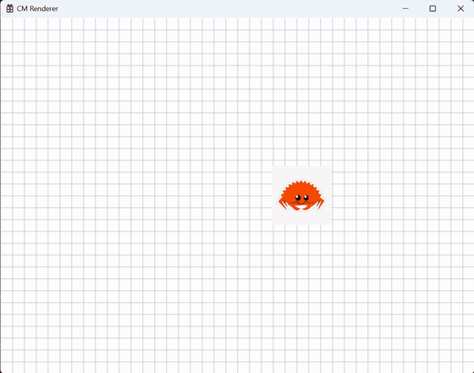
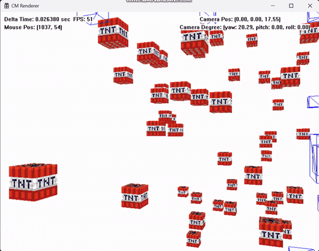
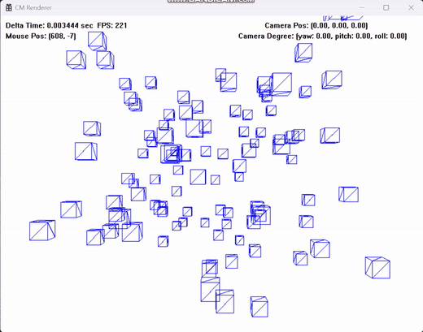
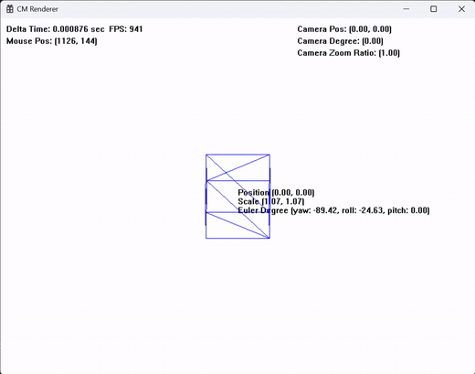
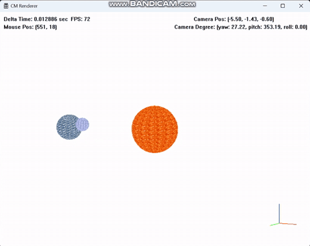

<h1 align="center">소프트웨어 래스터라이저 개발 기록</h1>

C++과 Win32 API로 구현한 소프트웨어 래스터라이저 학습·개발 기록

  
  

## 목차

* [프로젝트 소개](#프로젝트-소개)
* [2D 래스터화](#2d-래스터화)
* [3D 변환과 투영](#3d-변환과-투영)
* [원근 보정 텍스처 매핑](#원근-보정-텍스처-매핑)
* [깊이 버퍼](#깊이-버퍼)
* [로컬 공간의 절두체 컬링](#로컬-공간의-절두체-컬링)
* [클립 공간의 삼각형 클리핑](#클립-공간의-삼각형-클리핑)
* [사원수 회전](#사원수-회전)
* [트랜스폼 계층과 메시 출력](#트랜스폼-계층과-메시-출력)
* [개발 기록](#개발-기록)

## 프로젝트 소개

D3D11과 OpenGL에서는 API를 호출하면 화면이 그려지지만, 그 사이의 계산은 보이지 않습니다. 이 과정을 직접 확인하려고 GPU 없이 C++만으로 렌더링 파이프라인을 구현했습니다. 정점 변환, 원근 투영, 삼각형 래스터화, 텍스처 매핑, 깊이 버퍼, 컬링, 클리핑까지 CPU에서 계산하고, 결과 픽셀만 Win32 API로 창에 출력합니다.

2024년 1월부터 9월까지 필요한 수학을 공부하며 단계별로 구현하고 블로그에 기록했습니다. 이 저장소에서는 당시의 실행 영상과 단계별 구현 기록을 함께 볼 수 있습니다.

## 2D 래스터화

### 선 그리기와 색 보간

처음에는 두 점 사이를 매개변수로 보간하며 점을 찍었습니다. 간단한 방법이지만 매개변수의 증가량에 따라 필요 이상으로 많은 픽셀을 찍거나 선에 빈틈이 생길 수 있었습니다. 화면의 좌표는 정수이므로, 다음 픽셀을 정수 판별식으로 선택하는 브레젠험 알고리즘으로 바꿨습니다. 선의 경사가 완만한지 급한지에 따라 기준 축을 바꾸고, 시작점과 끝점의 방향에 맞춰 좌표를 증가시키거나 감소시켰습니다.

선의 양 끝에 서로 다른 색을 지정하고 중간 색도 보간했습니다. 색 보간을 정수 연산으로 바꾸는 과정에서는 색이 뚝뚝 끊기는 문제가 생겼습니다. 채널마다 더 넓은 정수로 계산하는 `Color128`을 두고, 실제 픽셀을 찍을 때 `Color32`로 되돌리는 방식으로 계산 정밀도를 높였습니다. 화면 밖으로 이어지는 선에는 코헨–서더랜드 클리핑을 적용해, 영역 코드를 비교하고 경계와의 교점으로 끝점을 옮겼습니다.

### 모델링 행렬과 카메라

오브젝트의 크기·회전·이동을 하나의 모델링 행렬로 묶었습니다. 로컬 좌표의 정점에 크기 변환을 적용하고, 회전시킨 뒤 월드의 위치로 이동하도록 순서를 정했습니다. 행렬 곱은 순서를 바꿀 수 없기 때문에, 이 적용 순서를 기준으로 행렬을 구성했습니다. `Transformer`에는 위치와 각도, 크기, 로컬 기저를 보관하고 여기서 모델링 행렬을 얻었습니다.

*같은 사각형의 정점에 서로 다른 모델링 변환을 적용한 결과입니다.*

카메라는 월드의 어느 부분을 화면에 담을지 정하는 기준입니다. 카메라가 이동하거나 회전한 만큼 모든 오브젝트에 반대 변환을 적용하면, 카메라를 원점에 둔 상태로 화면을 구성할 수 있습니다. 이를 위해 카메라 모델링 행렬의 역행렬인 뷰 행렬을 만들었습니다. 줌은 값이 커질수록 피사체가 커지도록 의미를 정하고, 뷰 행렬에도 그에 맞춰 반영했습니다.

### 삼각형 채우기와 텍스처

삼각형을 감싸는 가장 작은 사각형을 구하고, 그 안의 픽셀을 순회하며 삼각형 내부에 있는지 검사했습니다. 내적으로 구한 무게중심좌표의 세 계수가 모두 0과 1 사이에 있으면 내부의 픽셀로 판단했습니다. 세 점이 한 직선에 놓여 면적이 없는 퇴화 삼각형은 그리기에서 제외했습니다.

내부를 판정할 때 구한 계수로 꼭짓점의 색을 섞으면 색 보간이 됩니다. 정점에 이미지의 가로·세로 위치를 나타내는 UV 좌표를 추가하고 같은 방식으로 보간하면, 텍스처에서 해당 위치의 색을 읽어 삼각형에 입힐 수 있습니다. 삼각형을 찾는 계산과 픽셀에 들어갈 값을 보간하는 계산이 같은 계수로 연결됐습니다.

*삼각형 두 개로 사각형을 채우고, 꼭짓점의 색을 보간했습니다. 배경 격자는 카메라의 이동과 회전을 보여 줍니다.*

*색 대신 UV 좌표를 보간해 이미지를 입힌 결과입니다.*

## 3D 변환과 투영

### 3D 와이어프레임과 백페이스 컬링

2D에서 사용하던 구조를 3D 벡터와 정점, 4×4 행렬로 확장했습니다. 육면체를 정점 버퍼와 인덱스 버퍼로 정의하고, 삼각형의 모서리를 이어 와이어프레임을 그렸습니다. 처음에는 변환한 정점의 z를 버리고 x와 y만 사용했기 때문에, 물체는 회전하지만 거리에 따라 작아지는 원근감은 없었습니다.

회전은 먼저 오일러 각으로 구현했습니다. 롤 → 피치 → 요 순서로 적용하고, 열벡터를 사용하므로 행렬은 요 × 피치 × 롤 순서로 곱했습니다. 회전행렬의 각 열은 변환된 로컬 기저가 됩니다. 이 단계에서 확인한 짐벌락은 이후 사원수 회전으로 이어지는 계기가 됐습니다.

*삼각형 12개로 구성한 육면체의 와이어프레임입니다.*

후면의 삼각형은 보이지 않으므로 백페이스 컬링으로 그리기를 건너뛰었습니다. 삼각형 두 변의 외적으로 법선을 구하고 카메라 시선과의 내적으로 방향을 판정했습니다. 이 판정이 일관되려면 삼각형을 구성하는 정점의 순서도 맞아야 했습니다. 육면체의 인덱스를 정리한 뒤 보이는 면의 선만 남는지 확인했습니다.

*백페이스 컬링을 적용한 뒤에는 후면의 선이 나타나지 않습니다.*

### 카메라와 원근 투영

3D 카메라도 모델링 행렬의 역변환을 뷰 행렬로 사용했습니다. 이 렌더러에서 정한 카메라 방향에 맞춰 뷰 공간의 x축과 z축 방향을 뒤집었고, 카메라 앞쪽은 음의 z 방향이 되도록 구성했습니다. 그다음 화각으로부터 초점거리를 구하고, 닮은 삼각형의 비를 이용해 멀리 있는 정점이 작게 보이는 투영식을 만들었습니다.

깊이로 나누는 연산은 정점마다 값이 달라집니다. 이를 행렬에서 분리해, 먼저 모델링·뷰·투영 행렬을 곱한 클립 좌표를 구하고 마지막에 원근 나눗셈을 수행하도록 했습니다. 나눗셈 뒤 얻는 정규화 장치 좌표(NDC)를 화면 크기에 맞게 늘려 실제 픽셀 좌표로 옮겼습니다.

처음에는 정육면체가 가로로 늘어나 보였습니다. 가로·세로 범위가 같은 NDC를 4:3 화면으로 늘렸기 때문입니다. 화면의 종횡비를 a = 가로 / 세로로 두고, 투영 행렬의 x 방향에 1/a를 반영해 비율을 맞췄습니다.

<table width="100%">
  <tr>
    <td align="center"></td>
    <td align="center"></td>
  </tr>
  <tr>
    <td align="center">종횡비 보정 전</td>
    <td align="center">보정 후 여러 오브젝트를 배치한 결과</td>
  </tr>
</table>

## 원근 보정 텍스처 매핑

2D에서 쓰던 텍스처 매핑을 3D 상자에 적용하자, 상자가 회전할 때 기울어진 면의 텍스처가 찌그러졌습니다(왼쪽). 픽셀마다 화면에서 무게중심좌표를 구하고 그 비율로 세 정점의 UV를 섞었는데, 원근 투영은 정점마다 다른 깊이로 좌표를 나누므로 화면에서의 비율이 3D 공간의 비율과 같지 않습니다. 깊이 차이가 큰 면일수록 어긋남이 커집니다.

화면에서 구한 계수 λ를 각 정점의 클립 좌표 w로 나눈 뒤, 합이 다시 1이 되도록 정규화해 3D 공간의 비율로 되돌렸습니다. 이 렌더러에서 w는 카메라 공간의 깊이(−z)입니다.

$$
\beta_i = \frac{\lambda_i / w_i}{\lambda_0 / w_0 + \lambda_1 / w_1 + \lambda_2 / w_2}
$$

정점마다 1/w를 미리 구해 두고, 픽셀 루프에서 β를 계산합니다. 보정한 β로 UV를 보간하자 면이 기울어져도 텍스처가 면의 형태를 따라갔습니다(오른쪽).

## 깊이 버퍼

여러 상자를 배치하자 뒤에 있어야 할 상자가 앞의 상자를 뚫고 그려졌습니다. 화면의 같은 픽셀을 나중에 그린 오브젝트가 덮어쓰기 때문입니다. 오브젝트를 거리순으로 정렬하는 대신, 픽셀마다 현재 그려진 깊이를 보관하고 더 가까운 픽셀만 남기는 깊이 버퍼를 구현했습니다.

이를 위해 카메라에 근평면과 원평면을 추가하고, NDC의 z에 깊이 정보가 남도록 투영 행렬을 확장했습니다. 화면 크기만큼 실수 버퍼를 마련한 뒤 매 프레임 큰 값으로 초기화했습니다. 삼각형을 채울 때 새 픽셀의 깊이와 기존 값을 비교하고, 더 가까운 경우에만 색과 깊이를 함께 갱신했습니다.

*깊이 버퍼 유무에 따른 차이입니다. 겹친 부분에서 어느 상자의 면이 남는지 확인할 수 있습니다.*

이제 물체를 그린 순서와 별개로 픽셀의 앞뒤를 판단할 수 있게 됐습니다. 정점을 화면 위로 옮기는 원근 투영과, 같은 화면 위치에 겹친 면 중 무엇을 남길지 정하는 깊이 테스트를 각각 구현했습니다.

## 로컬 공간의 절두체 컬링

화면 밖의 픽셀은 그리지 않았지만, 화면 밖 물체의 정점 변환은 계속 수행되고 있었습니다. 카메라가 볼 수 있는 절두체를 평면 여섯 개로 표현하고, 완전히 밖에 있는 물체는 정점 변환 전에 제외했습니다.

처음에는 물체의 중심점 하나로 판정했는데, 중심은 밖에 있어도 메시 일부가 화면에 걸치는 물체가 잘려 나갔습니다. 그래서 메시의 정점 최솟값과 최댓값으로 축 정렬 경계 상자(AABB)를 만들고, 평면 법선의 부호에 따라 상자의 가장 안쪽과 바깥쪽 꼭짓점을 골라 검사했습니다. 이렇게 하면 평면마다 꼭짓점 두 개만 보고 상자가 완전히 밖인지, 경계에 걸치는지, 안쪽인지를 구분할 수 있습니다.

다음으로 판정을 수행하는 공간을 바꿨습니다. AABB를 매 프레임 뷰 공간으로 변환하면 축 정렬이 깨지고 꼭짓점 8개를 모두 변환해야 합니다. 반대로 절두체 평면을 물체의 로컬 공간으로 옮기면 원래 AABB를 그대로 쓸 수 있습니다. 클립 공간의 내부 조건 −w ≤ x, y, z ≤ w를 변환 전 좌표에 대한 부등식으로 풀면, 모델·뷰·투영을 합성한 행렬의 행을 더하고 빼는 것만으로 로컬 공간의 여섯 평면이 나옵니다. 물체마다 이미 계산하는 합성 행렬에서 평면을 꺼내므로, 추가 변환 없이 판정할 수 있습니다.

경계에 걸친 상자는 와이어프레임으로 표시해 판정 결과를 확인했습니다.

## 클립 공간의 삼각형 클리핑

카메라가 물체 위를 지나가면 선이 화면 끝까지 늘어나고 텍스처가 깨졌습니다. 큰 삼각형의 일부 정점이 카메라 뒤에 있는데 그대로 원근 나눗셈을 하면서, w가 음수인 정점이 화면 반대편으로 뒤집혀 투영된 것입니다. 이런 삼각형은 컬링으로 통째로 버릴 수도 없습니다. 보이는 부분이 남아 있기 때문입니다.

그래서 원근 나눗셈 전에 클립 좌표에서 삼각형을 절두체 경계로 잘랐습니다. 근평면은 클립 좌표에서 z + w = 0입니다. 변의 두 끝점 A, B에서 d = z + w를 구하면 교점의 위치는 다음과 같습니다.

$$
t = \frac{d_A}{d_A - d_B}, \qquad P = A + t(B - A)
$$

같은 t로 색과 UV도 보간합니다. 여섯 평면을 차례로 통과시키며, 평면 바깥에 있는 정점 수에 따라 삼각형을 다시 만듭니다.

<table width="100%">
  <thead>
    <tr>
      <th align="right">바깥 정점 수</th>
      <th align="left">처리</th>
    </tr>
  </thead>
  <tbody>
    <tr>
      <td align="right">0</td>
      <td>그대로 유지</td>
    </tr>
    <tr>
      <td align="right">1</td>
      <td>교점 두 개를 더해 남은 사각형을 삼각형 두 개로 분할</td>
    </tr>
    <tr>
      <td align="right">2</td>
      <td>교점 두 개로 작은 삼각형 하나를 만듦</td>
    </tr>
    <tr>
      <td align="right">3</td>
      <td>제외</td>
    </tr>
  </tbody>
</table>

새 삼각형도 원래 삼각형과 정점 순서를 같게 만들었습니다. 순서가 뒤집히면 다음 단계의 백페이스 컬링이 보이는 면을 뒷면으로 판단하기 때문입니다.

와이어프레임으로 보면 화면 경계에서 잘린 영역이 새 삼각형으로 나뉘어 있습니다.

## 사원수 회전

처음에는 회전을 오일러 각(롤, 피치, 요)으로 저장했습니다. 피치가 90도가 되자 롤과 요가 같은 축을 돌리게 되어, 위 화면처럼 서로 다른 축의 각도를 바꿔도 같은 방향으로만 회전했습니다. 회전 순서를 바꿔도 어느 한 자세에서는 같은 일이 생기므로, 각도 세 개로 상태를 저장하는 방식 자체를 바꿔야 했습니다.

내부 회전 상태를 사원수로 저장하고, 사람이 지정하는 오일러 각은 입력할 때 사원수로 변환했습니다. 렌더링에는 사원수에서 회전행렬을 만들어 씁니다. 두 회전 사이를 보간할 때는 구면 선형 보간(Slerp)을 사용했습니다. 두 사원수의 내적으로 짧은 회전 경로를 고르고, 두 회전이 매우 가까우면 선형 보간으로 처리합니다.

## 트랜스폼 계층과 메시 출력

렌더링 파이프라인을 구현한 뒤에는 부모의 변환을 자식이 이어받는 트랜스폼 계층도 실험했습니다. 부모를 중심으로 자식이 움직이고, 그 자식의 변환을 또 다른 자식이 따라가도록 연결했습니다. 아래 영상은 구체의 공전으로 이 계층을 확인한 결과입니다.

*부모의 변환을 이어받는 자식·손자 오브젝트입니다.*

마지막에는 기본 FBX 메시를 화면에 출력하고 하이 폴리 모델로 렌더링을 시험했습니다. [메시 출력 실험 기록](https://powerclabman.tistory.com/161)

## 개발 기록

| 구현 단계 | 블로그 원문 |
| --- | --- |
| 2D 래스터화 | [선 그리기](https://powerclabman.tistory.com/144) · [모델링 행렬](https://powerclabman.tistory.com/145) · [색 보간 실습](https://powerclabman.tistory.com/146) · [카메라](https://powerclabman.tistory.com/147) · [삼각형 채우기](https://powerclabman.tistory.com/149) · [텍스처 매핑](https://powerclabman.tistory.com/150) |
| 3D 변환과 가시성 | [와이어프레임](https://powerclabman.tistory.com/151) · [백페이스 컬링](https://powerclabman.tistory.com/152) · [원근 투영과 보간](https://powerclabman.tistory.com/153) · [깊이 버퍼](https://powerclabman.tistory.com/154) · [절두체 컬링](https://powerclabman.tistory.com/155) · [삼각형 클리핑](https://powerclabman.tistory.com/156) |
| 회전과 확장 실험 | [사원수 회전](https://powerclabman.tistory.com/157) · [Slerp](https://powerclabman.tistory.com/159) · [트랜스폼 상속과 메시 출력](https://powerclabman.tistory.com/161) |

수학 학습 기록

- 2024.01.31 — [함수에 대해서](https://powerclabman.tistory.com/78)
- 2024.02.01 — [벡터](https://powerclabman.tistory.com/82)
- 2024.02.03 — [선형결합, 기저와 차원](https://powerclabman.tistory.com/86)
- 2024.02.03 — [삼각함수](https://powerclabman.tistory.com/87)
- 2024.06.27 — [수: 가상 세계를 구성하는 가장 작은 단위](https://powerclabman.tistory.com/110)
- 2024.06.27 — [벡터: 가상 공간의 탄생](https://powerclabman.tistory.com/111)
- 2024.06.28 — [삼각함수: 회전을 위한 수학](https://powerclabman.tistory.com/112)
- 2024.06.28 — [행렬: 가상 세계의 변환 도구](https://powerclabman.tistory.com/113)
- 2024.06.30 — [공부 목적으로 사용할 수학 라이브러리](https://powerclabman.tistory.com/116)
- 2024.07.11 — [아핀 공간: 움직이는 가상 세계의 구축](https://powerclabman.tistory.com/123)
- 2024.07.11 — [내적: 벡터 공간의 분석과 응용](https://powerclabman.tistory.com/124)
- 2024.07.12 — [삼각형: 물체를 구성하는 가장 작은 단위](https://powerclabman.tistory.com/125)
- 2024.07.19 — [3차원 공간: 입체 공간의 생성](https://powerclabman.tistory.com/128)
- 2024.07.20 — [외적: 3차원 공간의 분석과 응용](https://powerclabman.tistory.com/129)
- 2024.07.20 — [원근 투영: 화면에 현실감을 부여하는 변환](https://powerclabman.tistory.com/130)
- 2024.07.21 — [절두체: 최적화된 3차원 공간](https://powerclabman.tistory.com/135)
- 2024.07.24 — [복소수: 2차원 평면의 수](https://powerclabman.tistory.com/136)
- 2024.07.25 — [오일러 공식: 허수로 표현하는 회전 변환](https://powerclabman.tistory.com/137)
- 2024.07.27 — [오일러 공식 증명](https://powerclabman.tistory.com/138)
- 2024.07.30 — [사원수: 4차원 수로 설계한 3차원 회전](https://powerclabman.tistory.com/140)
- 2024.08.09 — [컨벡스 결합에 대한 삽질](https://powerclabman.tistory.com/148)

