

# 소프트웨어 래스터라이저 개발 기록

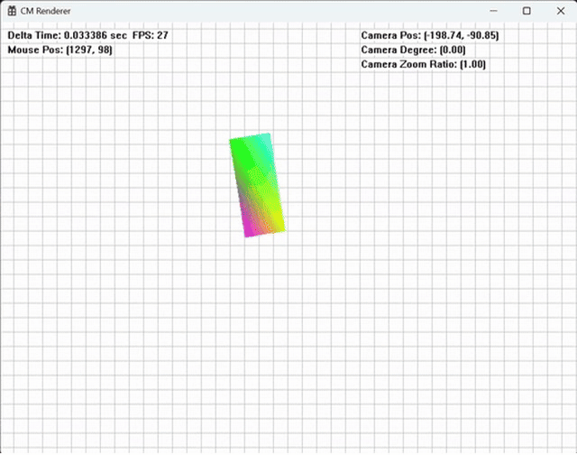

C++로 소프트웨어 래스터라이저를 직접 구현하며 정리한 컴퓨터 그래픽스 학습·개발 기록입니다. 필요한 수학을 공부하고, 정점을 변환해 삼각형을 만들고, 화면에 선을 긋고 색을 채우는 과정을 하나씩 구현했습니다.

처음 D3D11과 OpenGL을 봤을 때는 API를 호출하면 그림이 마법처럼 나타나는 것 같았습니다. 그래픽스 파이프라인에서 어떤 일이 일어나는지 감이 부족했고, 내부는 블랙박스처럼 느껴졌습니다. 그러던 중 GPU의 래스터화에 맡기지 않고 순수 C++로도 래스터라이저를 만들 수 있다는 것을 알게 됐습니다. 어떤 방식으로 동작할지 궁금해 찾아보니 필요한 내용 대부분이 수학이었고, 수학 공부와 GPU 파이프라인의 원리 학습을 함께 해보기로 했습니다.

학습 기록은 **2024년 1월 31일부터 9월 5일까지**이며, 렌더러 구현 글은 8~9월에 집중되어 있습니다. 원본 프로젝트는 분실했지만 당시 작성한 [블로그 기록](https://powerclabman.tistory.com/category/%EC%BB%B4%ED%93%A8%ED%84%B0%20%EA%B7%B8%EB%9E%98%ED%94%BD%EC%8A%A4)과 실행 영상이 남아 있어, 공부한 내용과 구현 과정을 이곳에 다시 모았습니다. 화면 출력에는 Win32 API를 사용했습니다.

## Contents

- [수학 학습](#수학-학습)
- [2D 래스터화](#2d-래스터화)
- [3D 변환과 투영](#3d-변환과-투영)
- [원근 보정 텍스처 매핑](#원근-보정-텍스처-매핑)
- [깊이 버퍼](#깊이-버퍼)
- [절두체 컬링](#절두체-컬링)
- [삼각형 클리핑](#삼각형-클리핑)
- [사원수와 회전 보간](#사원수와-회전-보간)
- [확장 실험](#확장-실험)
- [학습을 마치며](#학습을-마치며)
- [개발 기록](#개발-기록)

## 수학 학습

### 공간과 변환

처음에는 함수와 벡터, 선형결합과 기저, 삼각함수를 정리했습니다. 이후 수와 연산의 성질부터 다시 살펴보면서, 벡터로 공간을 표현하고 행렬로 그 공간을 변환하는 흐름으로 공부를 이어 갔습니다. 행렬의 원소를 외우는 것보다 기저벡터가 어떻게 바뀌는지를 따라가면 크기·회전·전단 변환을 직접 구성할 수 있었습니다.

이동 변환에서는 한 가지 차이가 있었습니다. 2차원 좌표에 일정한 값을 더하는 평행이동은 원점을 유지하지 않으므로 2×2 선형 변환 행렬로 표현할 수 없습니다. 좌표를 `(x, y, 1)`로 확장하면 이동도 3×3 행렬 곱으로 나타낼 수 있고, 다른 변환과 미리 합성할 수 있습니다. 이렇게 점과 방향 벡터를 구분하고 아핀 공간을 공부한 내용이 모델링 행렬과 카메라 구현의 바탕이 됐습니다.

관련 기록: [행렬](https://powerclabman.tistory.com/113) · [아핀 공간](https://powerclabman.tistory.com/123) · [공부용 수학 라이브러리](https://powerclabman.tistory.com/116)

### 삼각형과 보간

물체를 화면에 그리기 위해서는 삼각형을 표현하고 그 내부를 채울 수 있어야 했습니다. 세 점을 계수의 합이 1이 되도록 결합하는 아핀 결합에서 출발해, 각 계수를 0과 1 사이로 제한하는 컨벡스 결합을 공부했습니다. 삼각형 내부의 점을 세 꼭짓점의 비율로 표현한 것이 무게중심좌표이며, 이 비율은 내부 판정뿐 아니라 색과 UV 좌표를 보간하는 데에도 사용됩니다.

공식이 바로 이해되지는 않아 [컨벡스 결합의 조건을 따로 전개해 본 기록](https://powerclabman.tistory.com/148)도 남겼습니다. 계수의 범위와 합의 조건을 다시 따라간 뒤, 내적을 이용해 무게중심좌표를 계산하고 실제 픽셀을 채우는 코드로 연결했습니다.

관련 기록: [내적](https://powerclabman.tistory.com/124) · [삼각형과 무게중심좌표](https://powerclabman.tistory.com/125)

### 투영과 회전

3D에서는 좌표계를 정하고 카메라 기준으로 공간을 변환한 뒤, 원근감을 가진 2D 화면으로 옮기는 과정이 필요했습니다. 외적으로 면의 법선을 구하고, 내적으로 방향을 비교하는 방법은 백페이스 컬링에 사용했습니다. 원근 투영에서는 화각과 초점거리, 종횡비, 클립 좌표와 원근 나눗셈을 공부했고, 평면의 방정식과 바운딩 볼륨은 시야 밖 물체를 거르는 절두체 컬링으로 이어졌습니다.

회전은 오일러 각만으로 끝나지 않았습니다. 짐벌락과 회전 보간을 다루기 위해 복소수와 오일러 공식, 사원수까지 공부했습니다. 복소평면의 회전에서 출발해 사원수의 곱을 내적과 외적으로 나타내고, 오일러 각·회전행렬과 서로 변환하는 과정을 정리했습니다. 이렇게 공부한 수학을 뒤의 구현에서 실제 화면과 대조했습니다.

관련 기록: [3차원 공간](https://powerclabman.tistory.com/128) · [외적](https://powerclabman.tistory.com/129) · [원근 투영](https://powerclabman.tistory.com/130) · [절두체](https://powerclabman.tistory.com/135) · [사원수](https://powerclabman.tistory.com/140)

## 2D 래스터화

### 선 그리기와 색 보간

처음에는 두 점 사이를 매개변수로 보간하며 점을 찍었습니다. 간단한 방법이지만 매개변수의 증가량에 따라 필요 이상으로 많은 픽셀을 찍거나 선에 빈틈이 생길 수 있었습니다. 화면의 좌표는 정수이므로, 다음 픽셀을 정수 판별식으로 선택하는 브레젠험 알고리즘으로 바꿨습니다. 선의 경사가 완만한지 급한지에 따라 기준 축을 바꾸고, 시작점과 끝점의 방향에 맞춰 좌표를 증가시키거나 감소시켰습니다.

선의 양 끝에 서로 다른 색을 지정하고 중간 색도 보간했습니다. 색 보간을 정수 연산으로 바꾸는 과정에서는 색이 뚝뚝 끊기는 문제가 생겼습니다. 채널마다 더 넓은 정수로 계산하는 `Color128`을 두고, 실제 픽셀을 찍을 때 `Color32`로 되돌리는 방식으로 계산 정밀도를 높였습니다. 화면 밖으로 이어지는 선에는 코헨–서더랜드 클리핑을 적용해, 영역 코드를 비교하고 경계와의 교점으로 끝점을 옮겼습니다.

[관련 개발 기록 — 선 그리기](https://powerclabman.tistory.com/144)

### 모델링 행렬과 카메라

오브젝트의 크기·회전·이동을 하나의 모델링 행렬로 묶었습니다. 로컬 좌표의 정점에 크기 변환을 적용하고, 회전시킨 뒤 월드의 위치로 이동하도록 순서를 정했습니다. 행렬 곱은 순서를 바꿀 수 없기 때문에, 이 적용 순서를 기준으로 행렬을 구성했습니다. `Transformer`에는 위치와 각도, 크기, 로컬 기저를 보관하고 여기서 모델링 행렬을 얻었습니다.

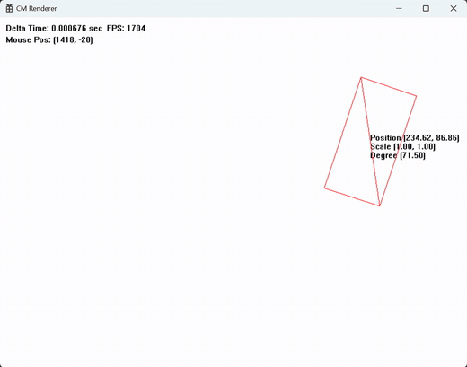

*같은 사각형의 정점에 서로 다른 모델링 변환을 적용한 결과입니다.*

카메라는 월드의 어느 부분을 화면에 담을지 정하는 기준입니다. 카메라가 이동하거나 회전한 만큼 모든 오브젝트에 반대 변환을 적용하면, 카메라를 원점에 둔 상태로 화면을 구성할 수 있습니다. 이를 위해 카메라 모델링 행렬의 역행렬인 뷰 행렬을 만들었습니다. 줌은 값이 커질수록 피사체가 커지도록 의미를 정하고, 뷰 행렬에도 그에 맞춰 반영했습니다.

관련 기록: [모델링 행렬](https://powerclabman.tistory.com/145) · [2D 카메라](https://powerclabman.tistory.com/147)

### 삼각형 채우기와 텍스처

삼각형을 감싸는 가장 작은 사각형을 구하고, 그 안의 픽셀을 순회하며 삼각형 내부에 있는지 검사했습니다. 내적으로 구한 무게중심좌표의 세 계수가 모두 0과 1 사이에 있으면 내부의 픽셀로 판단했습니다. 세 점이 한 직선에 놓여 면적이 없는 퇴화 삼각형은 그리기에서 제외했습니다.

내부를 판정할 때 구한 계수로 꼭짓점의 색을 섞으면 색 보간이 됩니다. 정점에 이미지의 가로·세로 위치를 나타내는 UV 좌표를 추가하고 같은 방식으로 보간하면, 텍스처에서 해당 위치의 색을 읽어 삼각형에 입힐 수 있습니다. 삼각형을 찾는 계산과 픽셀에 들어갈 값을 보간하는 계산이 같은 계수로 연결됐습니다.

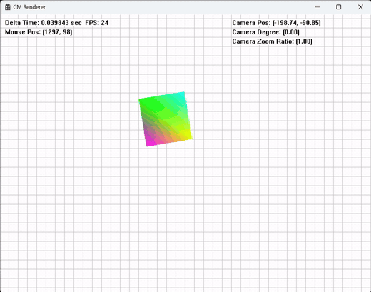

*삼각형 두 개로 사각형을 채우고, 꼭짓점의 색을 보간했습니다. 배경 격자는 카메라의 이동과 회전을 보여 줍니다.*

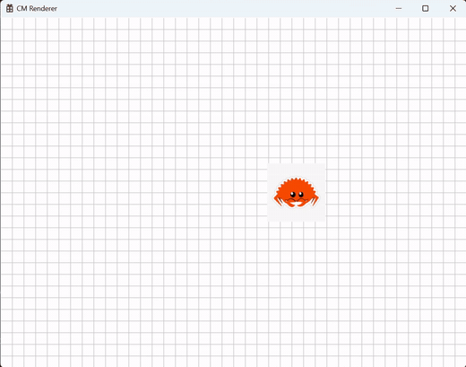

*색 대신 UV 좌표를 보간해 이미지를 입힌 결과입니다.*

관련 기록: [색칠된 삼각형](https://powerclabman.tistory.com/149) · [삼각형·텍스처 실습](https://powerclabman.tistory.com/150)

## 3D 변환과 투영

### 3D 와이어프레임과 백페이스 컬링

2D에서 사용하던 구조를 3D 벡터와 정점, 4×4 행렬로 확장했습니다. 육면체를 정점 버퍼와 인덱스 버퍼로 정의하고, 삼각형의 모서리를 이어 와이어프레임을 그렸습니다. 처음에는 변환한 정점의 z를 버리고 x와 y만 사용했기 때문에, 물체는 회전하지만 거리에 따라 작아지는 원근감은 없었습니다.

회전은 먼저 오일러 각으로 구현했습니다. 롤 → 피치 → 요 순서로 적용하고, 열벡터를 사용하므로 행렬은 요 × 피치 × 롤 순서로 곱했습니다. 회전행렬의 각 열은 변환된 로컬 기저가 됩니다. 이 단계에서 확인한 짐벌락은 이후 사원수 회전으로 이어지는 계기가 됐습니다.

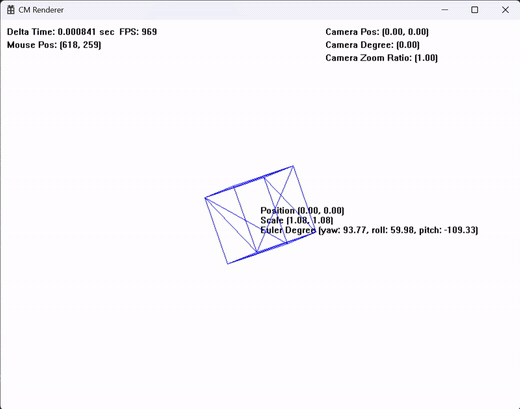

*삼각형 12개로 구성한 육면체의 와이어프레임입니다.*

후면의 삼각형은 보이지 않으므로 백페이스 컬링으로 그리기를 건너뛰었습니다. 삼각형 두 변의 외적으로 법선을 구하고 카메라 시선과의 내적으로 방향을 판정했습니다. 이 판정이 일관되려면 삼각형을 구성하는 정점의 순서도 맞아야 했습니다. 육면체의 인덱스를 정리한 뒤 보이는 면의 선만 남는지 확인했습니다.

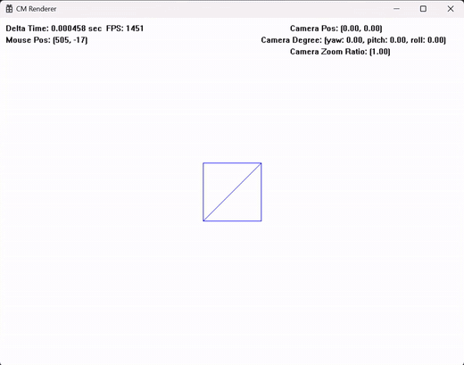

*백페이스 컬링을 적용한 뒤에는 후면의 선이 나타나지 않습니다.*

관련 기록: [3D 와이어프레임](https://powerclabman.tistory.com/151) · [백페이스 컬링](https://powerclabman.tistory.com/152)

### 카메라와 원근 투영

3D 카메라도 모델링 행렬의 역변환을 뷰 행렬로 사용했습니다. 이 렌더러에서 정한 카메라 방향에 맞춰 뷰 공간의 x축과 z축 방향을 뒤집었고, 카메라 앞쪽은 음의 z 방향이 되도록 구성했습니다. 그다음 화각으로부터 초점거리를 구하고, 닮은 삼각형의 비를 이용해 멀리 있는 정점이 작게 보이는 투영식을 만들었습니다.

깊이로 나누는 연산은 정점마다 값이 달라집니다. 이를 행렬에서 분리해, 먼저 모델링·뷰·투영 행렬을 곱한 클립 좌표를 구하고 마지막에 원근 나눗셈을 수행하도록 했습니다. 나눗셈 뒤 얻는 정규화 장치 좌표(NDC)를 화면 크기에 맞게 늘려 실제 픽셀 좌표로 옮겼습니다.

처음에는 정육면체가 가로로 늘어나 보였습니다. 가로·세로 범위가 같은 NDC를 4:3 화면으로 늘렸기 때문입니다. 화면의 종횡비를 a = 가로 / 세로로 두고, 투영 행렬의 x 방향에 1/a를 반영해 비율을 맞췄습니다.

<table>
  <tr>
    <td align="center">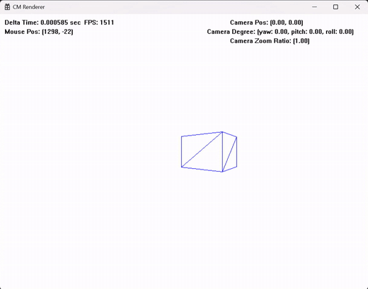</td>
    <td align="center">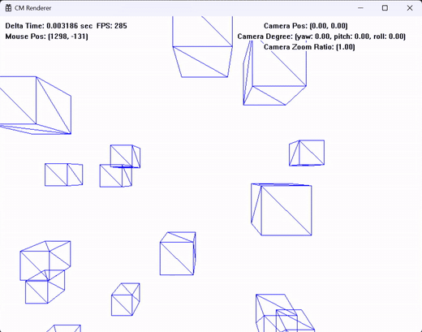</td>
  </tr>
  <tr>
    <td align="center">종횡비 보정 전</td>
    <td align="center">보정 후 여러 오브젝트를 배치한 결과</td>
  </tr>
</table>

[관련 개발 기록 — 3D 카메라와 원근법](https://powerclabman.tistory.com/153)

## 원근 보정 텍스처 매핑

2D에서 사용한 텍스처 매핑을 3D 육면체에도 적용했습니다. 삼각형 내부의 픽셀마다 무게중심좌표를 구하고, 그 비율로 세 정점의 UV 좌표를 섞어 텍스처의 색을 가져왔습니다. 정면에서는 그럴듯했지만, 상자를 회전시키자 기울어진 면의 텍스처가 찌그러지는 문제가 보였습니다.

문제는 무게중심좌표를 계산한 공간에 있었습니다. 화면에 그려진 삼각형은 원근 투영을 거친 결과입니다. 이 과정에서는 정점마다 깊이에 따라 좌표를 나누기 때문에, 투영 전 삼각형에서의 보간 비율이 화면에서도 그대로 유지되지는 않습니다. 화면에서 구한 비율로 UV를 곧바로 보간하면, 깊이가 서로 다른 정점 사이에서 텍스처의 위치가 어긋나게 됩니다.

이를 해결하기 위해 화면에서 구한 무게중심좌표를 투영 전의 보간 비율로 보정했습니다. 화면의 무게중심 계수를 λ, 각 정점의 클립 좌표 w를 이용하면 보정한 계수는 다음과 같습니다.

$$
\beta_i =
\frac{\lambda_i / w_i}
{\lambda_0 / w_0 + \lambda_1 / w_1 + \lambda_2 / w_2}
$$

이 렌더러의 투영 행렬에서는 w에 카메라 공간의 깊이를 양수로 나타낸 값, 즉 −z가 담깁니다. 각 계수를 w로 나눈 뒤, 세 계수의 합이 다시 1이 되도록 정규화한 것입니다. 이렇게 얻은 β로 UV를 보간하면 화면에서 단순히 선형 보간했을 때의 왜곡을 보정할 수 있습니다. 구현에서는 정점별 w의 역수를 미리 구해 두고, 삼각형을 채우는 픽셀 루프에서 보정한 계수를 계산했습니다.

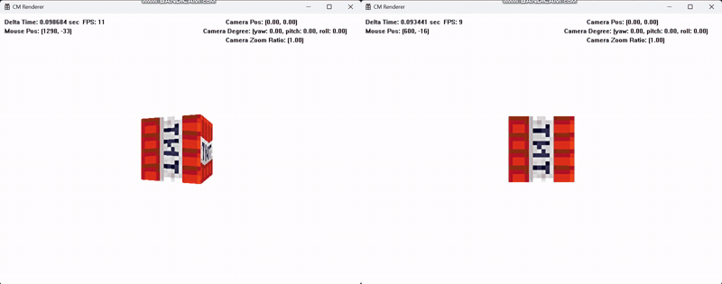

*왼쪽은 원근 보정 전, 오른쪽은 보정 후입니다. 상자가 회전할 때 옆면의 텍스처가 어떻게 달라지는지 비교할 수 있습니다.*

보정 후에는 면이 기울어져도 텍스처가 면의 형태에 맞게 표현됐습니다. 삼각형 안에 있는 픽셀을 찾는 데 사용한 무게중심좌표를 텍스처 보간에도 그대로 쓸 수 있을 것 같았지만, 원근 투영이 들어오면서 두 계산 사이에 보정이 필요했습니다.

[관련 개발 기록 — 원근 보정 보간](https://powerclabman.tistory.com/153)

## 깊이 버퍼

여러 상자를 배치하자 뒤에 있어야 할 상자가 앞의 상자를 뚫고 그려졌습니다. 화면의 같은 픽셀을 나중에 그린 오브젝트가 덮어쓰기 때문입니다. 오브젝트를 거리순으로 정렬하는 대신, 픽셀마다 현재 그려진 깊이를 보관하고 더 가까운 픽셀만 남기는 깊이 버퍼를 구현했습니다.

이를 위해 카메라에 근평면과 원평면을 추가하고, NDC의 z에 깊이 정보가 남도록 투영 행렬을 확장했습니다. 화면 크기만큼 실수 버퍼를 마련한 뒤 매 프레임 큰 값으로 초기화했습니다. 삼각형을 채울 때 새 픽셀의 깊이와 기존 값을 비교하고, 더 가까운 경우에만 색과 깊이를 함께 갱신했습니다.

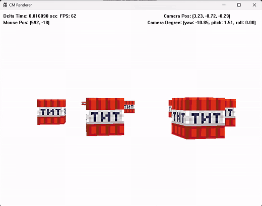

*깊이 버퍼 유무에 따른 차이입니다. 겹친 부분에서 어느 상자의 면이 남는지 확인할 수 있습니다.*

이제 물체를 그린 순서와 별개로 픽셀의 앞뒤를 판단할 수 있게 됐습니다. 정점을 화면 위로 옮기는 원근 투영과, 같은 화면 위치에 겹친 면 중 무엇을 남길지 정하는 깊이 테스트를 각각 구현했습니다.

[관련 개발 기록 — 깊이 구현](https://powerclabman.tistory.com/154)

## 절두체 컬링

### 시야 밖의 오브젝트

화면 밖으로 나간 물체는 픽셀을 찍는 단계에서 걸러지고 있었지만, 그전의 정점 변환은 계속 수행되고 있었습니다. 보이지 않는 오브젝트에도 모델링·뷰·투영 연산을 적용하는 낭비를 줄이기 위해, 카메라가 볼 수 있는 범위인 절두체 밖의 물체를 먼저 제외했습니다.

절두체를 여섯 개의 평면으로 표현하고, 점이 각 평면의 어느 쪽에 있는지 검사했습니다. 평면을 n·p + d = 0으로 두고 법선 n이 절두체 바깥을 향하게 정하면, n·p + d가 양수인 점은 해당 평면의 바깥에 있습니다. 처음에는 오브젝트의 위치를 뷰 공간으로 옮겨 이 점으로 판정했습니다. 좌우 평면에 종횡비를 반영하지 않아 잘리는 범위가 정사각형이 되는 문제도 발견해 수정했습니다.

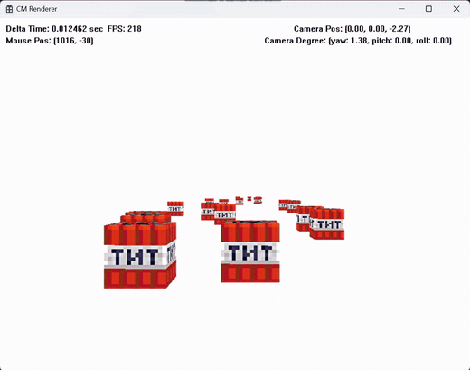

*오브젝트 위치를 기준으로 판정한 초기 절두체 컬링입니다.*

### AABB와 로컬 공간 판정

중심점만으로는 충분하지 않았습니다. 중심은 절두체 밖에 있어도 메시의 일부는 화면에 걸쳐 있을 수 있기 때문입니다. 메시의 정점별 최솟값과 최댓값으로 축에 정렬된 경계 상자(AABB)를 만들고, 점 대신 이 영역을 판정하도록 바꿨습니다. 평면 법선의 부호에 따라 상자의 양 끝점을 골라 검사하면 완전히 밖에 있는지, 경계와 겹치는지, 안쪽에 있는지를 구분할 수 있습니다.

그다음에는 컬링을 수행할 공간을 바꿨습니다. 바운딩 볼륨을 매번 뷰 공간으로 옮기는 대신, 절두체를 오브젝트의 로컬 공간에서 정의하면 원래 AABB를 그대로 사용할 수 있습니다. 클립 공간의 내부 조건인 −w ≤ x, y, z ≤ w를 변환 전 좌표에 대한 부등식으로 풀면, 모델링·뷰·투영을 합성한 행렬의 행 조합에서 여섯 평면을 얻을 수 있었습니다. 투영 행렬에서 평면을 추출하던 방식을 최종 합성 행렬로 확장한 것입니다.

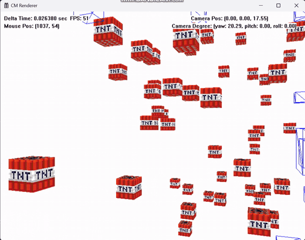

*경계에 걸친 오브젝트는 판정 결과를 확인하기 위해 와이어프레임으로 표시했습니다. 완전히 시야 밖에 있는 오브젝트는 그리기에서 제외합니다.*

이 과정에서는 무엇을 기준으로 가시성을 판단할지, 그 판정을 어느 좌표계에서 수행할지를 바꿨습니다. 중심점보다 메시의 영역을 반영하고, 바운딩 볼륨을 변환하는 대신 로컬 공간에서 판정하도록 개선했습니다.

[관련 개발 기록 — 가시부피와 절단](https://powerclabman.tistory.com/155)

## 삼각형 클리핑

### 카메라 뒤 정점의 투영

카메라가 오브젝트 위를 지나가면 선이 갑자기 길어지거나 텍스처가 깨지는 문제가 남아 있었습니다. 큰 삼각형의 일부 정점이 카메라 뒤에 있는데도 그대로 투영되면서, 화면에 엉뚱한 삼각형이 만들어지는 상황이었습니다. 뒤쪽 정점을 버리기만 하면 남은 두 점으로는 삼각형을 만들 수 없었습니다.

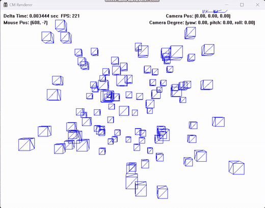

*클리핑을 넣기 전의 투영 문제입니다.*

절두체 컬링은 통째로 그리지 않아도 되는 오브젝트를 거르는 작업입니다. 반면 경계에 걸친 삼각형은 보이는 부분을 남겨야 합니다. 이를 위해 원근 나눗셈 전에 클립 좌표에서 삼각형을 자르고, 남은 영역을 새 삼각형으로 구성했습니다.

### 경계 교점과 삼각형 분할

절두체 경계와 삼각형의 변이 만나는 교점은 선분의 보간식으로 구했습니다. 예를 들어 이 렌더러의 근평면은 클립 좌표에서 z + w = 0입니다. 선분의 두 끝점 A, B에 대해 dA = zA + wA, dB = zB + wB로 두면, A에서 B로 향하는 교점의 비율 t는 다음과 같습니다.

$$
t = \frac{d_A}{d_A - d_B}, \qquad P = A + t(B-A)
$$

같은 비율로 위치뿐 아니라 색과 UV도 보간했습니다. 나머지 경계에도 해당하는 외부 판정식과 교점 계산을 마련하고, 여섯 평면을 차례로 통과시키며 삼각형을 갱신했습니다. 한 평면을 기준으로 바깥 정점의 수에 따라 처리가 달라집니다.

| 바깥 정점 수 | 남은 영역의 처리 |
|---|---|
| 0개 | 삼각형을 그대로 유지 |
| 1개 | 교점 두 개로 사각형이 남으므로 삼각형 두 개로 분할 |
| 2개 | 교점 두 개를 구해 작은 삼각형 하나로 축소 |
| 3개 | 삼각형을 그리기에서 제외 |

새 삼각형을 만들 때는 정점의 정의 방향도 유지해야 했습니다. 순서가 뒤집히면 앞에서 구현한 백페이스 컬링이 보이는 면을 후면으로 판단할 수 있기 때문입니다. 클리핑 자체뿐 아니라 그 결과가 다음 처리 단계에서도 같은 의미를 갖도록 맞췄습니다.

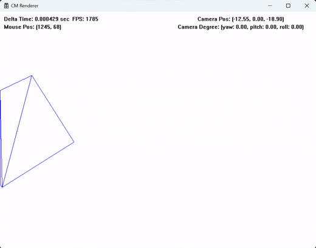

*와이어프레임으로 잘린 경계와 새로 구성된 삼각형을 확인했습니다.*

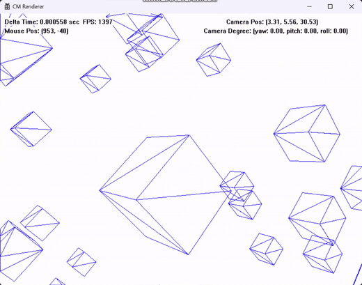

*다수의 도형에 클리핑을 적용한 결과입니다. 카메라가 상자에 가까이 접근하는 상황을 확인했습니다.*

[관련 개발 기록 — 삼각형 클리핑](https://powerclabman.tistory.com/156)

## 사원수와 회전 보간

오일러 각을 이용한 회전에서는 특정 자세에서 회전축이 겹쳐 자유도 하나를 잃는 짐벌락을 확인했습니다. 아래 영상에서는 서로 다른 축의 각도를 바꿔도 같은 방향으로 회전하는 상황이 나타납니다. 회전 상태를 저장하는 방법을 바꿀 필요가 있었습니다.

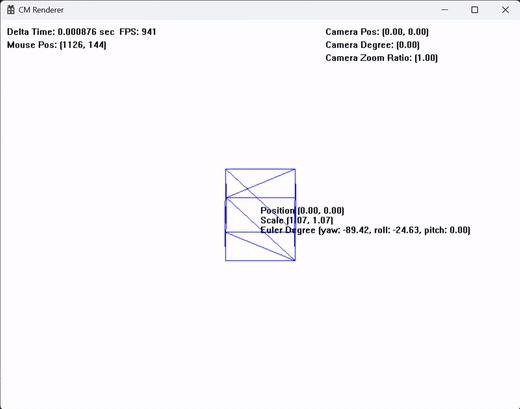

*사원수 도입의 계기가 된 오일러 각의 짐벌락 사례입니다.*

내부 회전 상태를 사원수로 저장하고, 사람이 지정하기 쉬운 오일러 각을 사원수로 변환하도록 했습니다. 렌더링에 사용할 때는 다시 회전행렬을 얻었습니다. 사원수의 곱과 벡터 회전은 내적·외적으로 정리한 식으로 구현했고, 오일러 각과의 변환은 관련 문서의 식을 이 렌더러의 회전 순서에 맞춰 적용했습니다.

두 회전 사이의 중간 상태를 구할 때는 구면 선형 보간(Slerp)을 사용했습니다. 두 사원수를 단순히 직선으로 섞는 대신 단위 구면의 원호를 따라 보간하는 계수를 구했습니다. 원문 코드에는 두 사원수의 내적을 이용해 짧은 회전 경로와 긴 경로를 선택하는 분기, 서로 매우 가까운 경우 선형 보간으로 처리하는 분기가 함께 남아 있습니다.

관련 기록: [짐벌락 없는 사원수 회전](https://powerclabman.tistory.com/157) · [Slerp](https://powerclabman.tistory.com/159)

## 확장 실험

렌더링 파이프라인을 구현한 뒤에는 부모의 변환을 자식이 이어받는 트랜스폼 계층도 실험했습니다. 부모를 중심으로 자식이 움직이고, 그 자식의 변환을 또 다른 자식이 따라가도록 연결했습니다. 아래 영상은 구체의 공전으로 이 계층을 확인한 결과입니다.

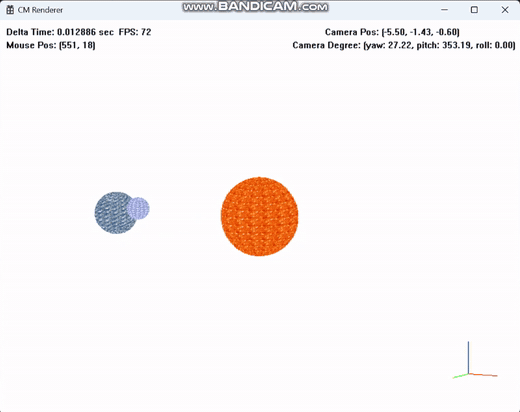

*부모의 변환을 이어받는 자식·손자 오브젝트입니다.*

마지막 기록에는 고폴리 메시와 외부 모델 출력, 파일 추출 실험도 남아 있습니다. 기본적인 FBX 메시를 출력하는 것까지 시도했지만, 렌더러의 본 계층과 FBX 내부 정보를 연결하는 부분은 완성하지 못했습니다. 이 부분은 완성된 애니메이션 기능이 아니라 확장 실험으로 남겼습니다.

[관련 개발 기록 — 직접 만든 그래픽 엔진으로 여러 가지 출력](https://powerclabman.tistory.com/161)

## 학습을 마치며

처음에는 D3D11이나 OpenGL을 사용하면 어떻게 그림이 나타나는지 막연했습니다. 직접 구현하면서는 정점의 위치를 바꾸고, 삼각형을 나누고 자르고, 선을 긋고 색을 채우는 과정이 실제 화면에서 어떻게 이어지는지 볼 수 있었습니다. 그래픽스 파이프라인 전체에서 대략 어떤 일이 일어나는지 감을 잡을 수 있었습니다.

수학도 따로 외워야 하는 공식에만 머물지 않았습니다. 벡터와 행렬은 물체와 카메라를 움직이는 계산이 됐고, 무게중심좌표는 삼각형의 내부와 색을 정하는 기준이 됐습니다. 투영과 클리핑을 직접 고치면서 좌표가 변환되는 순서와 공간을 구분할 수 있었습니다. API 뒤에서 일어나는 과정이 직접 만들어 보니 눈에 보이기 시작했다는 점이 이 학습에서 가장 좋았습니다.

## 개발 기록

본문에서 설명한 과정의 상세한 유도와 당시 코드·실험 기록은 아래 글에 남아 있습니다. 블로그에 삽입했던 동영상은 현재 서비스 종료로 재생되지 않아, 이 README에는 남아 있는 로컬 녹화본에서 만든 GIF를 사용했습니다. 영상 속 FPS는 당시 화면에 표시된 값이며 현재 환경에서 다시 측정한 성능 지표가 아닙니다.

수학 학습 기록

- 2024.01.31 — [함수에 대해서](https://powerclabman.tistory.com/78)
- 2024.02.01 — [벡터](https://powerclabman.tistory.com/82)
- 2024.02.03 — [선형결합, 기저와 차원](https://powerclabman.tistory.com/86)
- 2024.02.03 — [삼각함수](https://powerclabman.tistory.com/87)
- 2024.06.27 — [수: 가상 세계를 구성하는 가장 작은 단위](https://powerclabman.tistory.com/110)
- 2024.06.27 — [벡터: 가상 공간의 탄생](https://powerclabman.tistory.com/111)
- 2024.06.28 — [삼각함수: 회전을 위한 수학](https://powerclabman.tistory.com/112)
- 2024.06.28 — [행렬: 가상 세계의 변환 도구](https://powerclabman.tistory.com/113)
- 2024.06.30 — [공부 목적으로 사용할 수학 라이브러리](https://powerclabman.tistory.com/116)
- 2024.07.11 — [아핀 공간: 움직이는 가상 세계의 구축](https://powerclabman.tistory.com/123)
- 2024.07.11 — [내적: 벡터 공간의 분석과 응용](https://powerclabman.tistory.com/124)
- 2024.07.12 — [삼각형: 물체를 구성하는 가장 작은 단위](https://powerclabman.tistory.com/125)
- 2024.07.19 — [3차원 공간: 입체 공간의 생성](https://powerclabman.tistory.com/128)
- 2024.07.20 — [외적: 3차원 공간의 분석과 응용](https://powerclabman.tistory.com/129)
- 2024.07.20 — [원근 투영: 화면에 현실감을 부여하는 변환](https://powerclabman.tistory.com/130)
- 2024.07.21 — [절두체: 최적화된 3차원 공간](https://powerclabman.tistory.com/135)
- 2024.07.24 — [복소수: 2차원 평면의 수](https://powerclabman.tistory.com/136)
- 2024.07.25 — [오일러 공식: 허수로 표현하는 회전 변환](https://powerclabman.tistory.com/137)
- 2024.07.27 — [오일러 공식 증명](https://powerclabman.tistory.com/138)
- 2024.07.30 — [사원수: 4차원 수로 설계한 3차원 회전](https://powerclabman.tistory.com/140)
- 2024.08.09 — [컨벡스 결합에 대한 삽질](https://powerclabman.tistory.com/148)

구현과 실행 기록

- 2024.08.06 — [선 그리기](https://powerclabman.tistory.com/144)
- 2024.08.06 — [모델링 행렬 설계](https://powerclabman.tistory.com/145)
- 2024.08.07 — [색상 보간, 모델링 행렬 실습](https://powerclabman.tistory.com/146)
- 2024.08.08 — [2D 카메라 설계](https://powerclabman.tistory.com/147)
- 2024.08.09 — [색칠된 삼각형 그리기](https://powerclabman.tistory.com/149)
- 2024.08.10 — [삼각형, 텍스처 매핑 실습](https://powerclabman.tistory.com/150)
- 2024.08.11 — [3D 와이어프레임 렌더링](https://powerclabman.tistory.com/151)
- 2024.08.11 — [백페이스 컬링](https://powerclabman.tistory.com/152)
- 2024.08.12 — [3D 카메라 설계 수정, 원근법 구현](https://powerclabman.tistory.com/153)
- 2024.08.14 — [깊이 구현](https://powerclabman.tistory.com/154)
- 2024.08.15 — [가시부피와 절단](https://powerclabman.tistory.com/155)
- 2024.08.19 — [삼각형 클리핑](https://powerclabman.tistory.com/156)
- 2024.08.20 — [짐벌락 없는 사원수 회전](https://powerclabman.tistory.com/157)
- 2024.08.27 — [구면 선형 보간으로 회전 보간](https://powerclabman.tistory.com/159)
- 2024.09.05 — [직접 만든 그래픽 엔진으로 여러 가지 출력](https://powerclabman.tistory.com/161)

